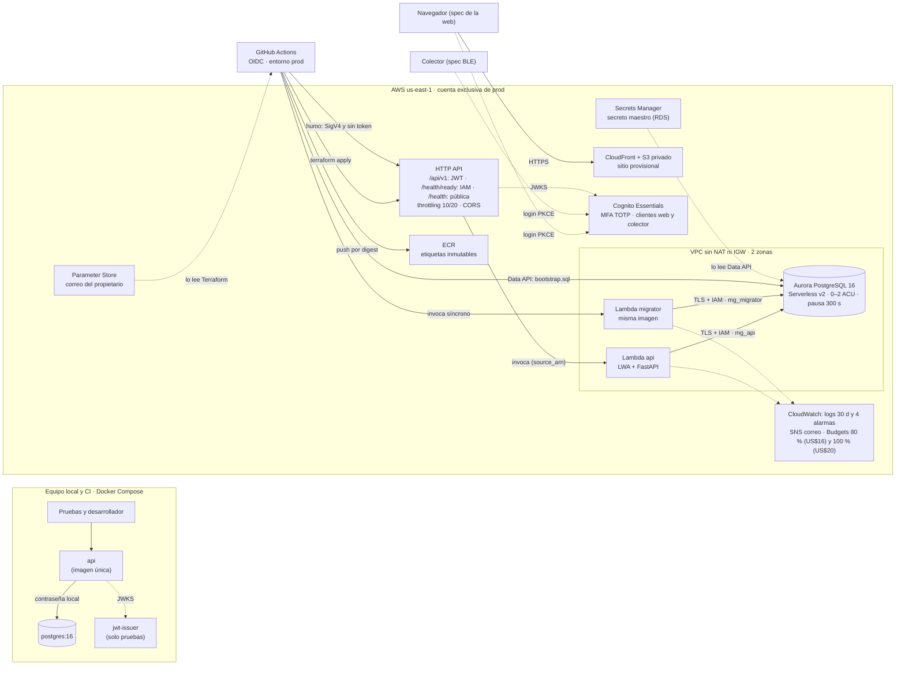
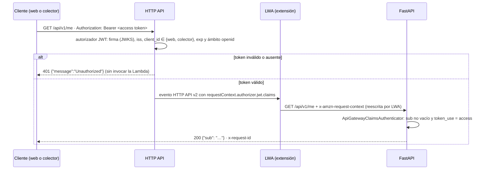

# Design Document

## Overview

Esta spec construye el **esqueleto desplegable** de monitorglucosa: todo lo necesario para que las siguientes specs
solo añadan funcionalidad, sin tocar plataforma.

- **Backend:** FastAPI con Clean Architecture. Una única imagen corre en Docker Compose, en CI y en Lambda (Lambda Web
  Adapter, LWA). Expone `/health`, `/health/ready` y `GET /api/v1/me`.
- **Autenticación:** un puerto con dos adaptadores. En `prod` lee los claims del autorizador JWT de API Gateway; en
  `local`/`test`, valida contra la JWKS de un emisor de pruebas.
- **Infraestructura de `prod`:** una raíz de Terraform con un estado remoto en S3 y 7 módulos: bootstrap, red, base de
  datos, identidad, API, sitio y operación.
- **Despliegue:** por digest y en dos fases. Primero el bootstrap SQL y las migraciones, desde una Lambda `migrator`
  dentro de la VPC; después la API. Termina con la prueba de humo y vuelve atrás si falla.
- **Contrato y documentación:** el contrato OpenAPI 3.1 de la spec ([openapi.yaml](openapi.yaml)) se escribe antes
  que el código. CI comprueba que el esquema que genera FastAPI, la referencia `docs/api/README.md` y las respuestas
  reales de la API son conformes con él (NFR-6). Swagger UI y ReDoc están disponibles en local.

Restricciones de AWS verificadas que dan forma al diseño (fuentes al final de cada decisión):

| Hecho verificado | Consecuencia en el diseño |
| --- | --- |
| HTTP API corta toda integración a los 30 s; la cuota no se puede ampliar | La reanudación de Aurora se resuelve con 503 y reintentos (D7) |
| HTTP API no tiene *custom gateway responses* (solo REST API) | El cuerpo uniforme cubre lo que responde la API (2.3 reformulado; D6) |
| Aurora tarda ~15 s en reanudar, o 30 s o más tras más de 24 h en pausa; una petición de Data API también la reanuda | Timeout de conexión de 20 s, presupuesto de 60 s con reintentos (NFR-2) |
| Data API no admite varias sentencias por llamada; devuelve `DatabaseResumingException` mientras Aurora reanuda | Bootstrap en un único bloque `DO $$ … $$` con reintentos (D3) |
| Lambda rechaza imágenes multiarquitectura; una función sin invocaciones durante semanas pasa a `Inactive` y rechaza la primera invocación | Construcción con `--provenance=false --sbom=false`; el despliegue espera a que la función esté activa (D2, D5) |
| Si ECR borra la imagen de una función, la función pasa a `Failed` | `deploy.py` comprueba que el digest en servicio sigue en ECR (D5) |
| Las alarmas de CloudWatch no pueden publicar en un tema SNS cifrado con `aws/sns` | Tema de alarmas sin cifrado en reposo; los mensajes no contienen datos personales (D14) |
| LWA reescribe `x-amzn-request-context` con `HeaderMap::insert`; los eventos que no son HTTP llegan como `POST` a `AWS_LWA_PASS_THROUGH_PATH` (por defecto `/events`) | Un cliente no puede inyectar claims (D9); mecanismo del `migrator` (D2) |
| Con `manage_master_user_password`, Secrets Manager rota la contraseña maestra cada 7 días | Data API lee el secreto en cada llamada; nada guarda la contraseña (D3) |
| El autorizador JWT evalúa `aud` antes que `client_id` y no distingue un ID token de un access token; AWS recomienda exigir ámbitos en las rutas | `authorization_scopes = ["openid"]` en `/api/v1`, además de `token_use = access` en la API (D9) |
| AWS no documenta el código exacto que devuelve HTTP API por timeout de la integración (la comunidad observa 503), ni el cuerpo de un rechazo IAM | El contrato los modela como `ApiGatewayMessage` sin fijar el texto; la verificación manual registra lo observado (D16) |

## Architecture



**Límites de confianza.** Hay tres límites:

1. **Internet → API Gateway:** ninguna ruta de `/api/v1` llega a la Lambda sin un JWT válido de Cognito, y
   `/health/ready` exige una firma SigV4. La Lambda `api` solo puede invocarla esta API (permiso con `source_arn`). El
   `migrator` solo puede invocarlo el rol de despliegue.
2. **Lambda → Aurora:** solo pasan los grupos de seguridad `api` y `migrator`, con TLS obligatorio
   (`rds.force_ssl = 1`) y autenticación IAM. El token IAM se firma localmente, sin red (ADR 0004).
3. **GitHub → AWS:** OIDC con la condición `sub` del entorno `prod` y aprobación manual del propietario. Todo lo que
   necesita red pública (ECR, Terraform, invocación del `migrator`, Data API y prueba de humo) ocurre en el pipeline,
   nunca dentro de la VPC.

### Petición autenticada en `prod`



### Despliegue en dos fases

```mermaid
sequenceDiagram
    participant GH as deploy.py (job deploy)
    participant ECR
    participant TF as Terraform
    participant DAPI as RDS Data API
    participant MIG as Lambda migrator
    participant GW as HTTP API → Lambda api
    GH->>ECR: docker push (imagen del job build) → D_new
    GH->>TF: output api_image_digest → D_prev (vacío la primera vez)
    GH->>ECR: describe-images D_prev (si falta, se detiene)
    GH->>TF: apply (infraestructura; migrator = D_new; api = D_prev o D_new)
    GH->>DAPI: bootstrap.sql (reintenta ante DatabaseResumingException, hasta 120 s)
    GH->>MIG: wait function-active-v2 → invoke síncrono
    alt status ≠ ok
        MIG-->>GH: error → despliegue fallido; la API sigue en D_prev
    else migración correcta
        GH->>TF: apply (api = D_new)
        loop hasta 200 o 120 s, respetando Retry-After
            GH->>GW: GET /health/ready firmado con SigV4
        end
        GH->>GW: GET /api/v1/me sin token → debe ser 401
        alt la prueba de humo falla y existe D_prev
            GH->>TF: apply (api = D_prev) → despliegue fallido
        end
    end
```

### Primer despliegue (bootstrap)

Lo ejecuta el propietario una sola vez. El runbook se escribe en `docs/guia-de-desarrollo.md`.

| Paso | Quién y dónde | Acción |
| --- | --- | --- |
| 0 | Propietario, consola de AWS | Crear la cuenta exclusiva; MFA en el usuario raíz, sin claves de acceso; IAM Identity Center con un usuario administrador con MFA |
| 1 | Propietario, equipo local | Herramientas: AWS CLI v2 (`aws sso login`), Terraform 1.16.6, Docker y uv |
| 2 | Propietario, equipo local | `aws ssm put-parameter --name /monitorglucosa/prod/owner-email --type SecureString` con su correo, que nunca entra en el repositorio |
| 3 | Propietario, equipo local | `terraform apply -target=module.bootstrap` con un `backend_override.tf` local (ignorado por git): bucket del estado, OIDC, rol de despliegue, boundary y ECR |
| 4 | Propietario, equipo local | Quitar el override y ejecutar `terraform init -migrate-state` al backend S3 |
| 5 | Propietario, GitHub | Secretos del entorno `prod`: `AWS_DEPLOY_ROLE_ARN` y `TF_STATE_BUCKET`, que se enmascaran en los logs; `kspec github apply` con el revisor de `prod` (`G-2`) y el check `ci` |
| 6 | Pipeline | El merge del PR dispara `deploy.yml`; tras la aprobación del propietario: apply completo, bootstrap SQL, migración, API y prueba de humo |
| 7 | Propietario | Confirmar la suscripción de SNS; primer inicio de sesión en la página de Cognito con la contraseña temporal y alta del TOTP; `manual-checks.md` |

### Límites de confianza y amenazas (STRIDE)

| Categoría | Amenaza concreta | Mitigación | Fuente |
| --- | --- | --- | --- |
| Suplantación | Un cliente envía su propia cabecera `x-amzn-request-context` con otro `sub` | LWA la sobrescribe; la Lambda solo se invoca desde la API; `token_use = access` | D9 |
| Suplantación | Se usa un ID token, o un token de otro user pool | El autorizador valida `iss`, `aud`/`client_id` y el ámbito `openid`, que los ID tokens no tienen; la API exige además `token_use = access` | 4.5, D9 |
| Manipulación | Una imagen alterada entre la prueba y el despliegue | Se despliega por digest la misma imagen que probó el job `build`; etiquetas inmutables y escaneo en ECR | D5 |
| Repudio | Cambios de infraestructura sin rastro | Solo el pipeline con aprobación aplica cambios; historial de eventos de CloudTrail (90 días) | `tech.md · Seguridad` |
| Divulgación | Datos o identificadores en los logs públicos de Actions | Resumen de plan, máscaras, `sensitive` y sin artefactos de plan | D4 |
| Divulgación | Valores de peticiones en logs o errores | Lista blanca de campos en los logs; `ErrorBody` sin valores; logs de PostgreSQL sin exportar | Properties 1 y 4 |
| Denegación de servicio | Bucle de un cliente o abuso externo que agota el presupuesto | Throttling 10/20; alarma «Aurora sin pausa»; Budgets | 6.3, D14 |
| Elevación | El rol de despliegue crea un rol administrador | *Permissions boundary* obligatorio; el rol no puede editar el boundary ni a sí mismo | D4 |
| Elevación | La API ejecuta DDL o lee el secreto maestro | `mg_api` solo tiene DML; las Lambdas no tienen permisos sobre Secrets Manager | D3 |

### Coste estimado (precios de lista de `us-east-1`, 2026-11-07)

Escenario de uso bajo: unas 3 sesiones al día (sincronización y consulta web), cada una con unos 10 minutos de Aurora
activa contando los 300 s previos a la pausa, más los despliegues y el mantenimiento (Aurora espera 20 min tras cada
operación administrativa).

| Concepto | Precio de lista | Supuesto | US$/mes |
| --- | --- | --- | --- |
| Aurora Serverless v2 (cómputo) | 0,12 / ACU-h | ~15 h activa × 0,75 ACU ≈ 12 ACU-h | 1,44 |
| Aurora (almacenamiento y E/S) | 0,10 / GB-mes · 0,20 / millón de E/S | 1 GB · < 0,5 M E/S | 0,20 |
| Backups de Aurora (7 días) | 0,021 / GB-mes por encima del tamaño del clúster | Dentro de la asignación gratuita | 0,00 |
| Secrets Manager (secreto maestro) | 0,40 / secreto | 1 secreto | 0,40 |
| CloudWatch: alarmas | 0,10 / alarma estándar | 4 alarmas | 0,40 |
| CloudWatch: logs | 0,50 / GB ingerido · 0,03 / GB-mes | < 0,1 GB | 0,05 |
| ECR | 0,10 / GB-mes | 10 imágenes ≈ 2 GB | 0,20 |
| Cognito Essentials | 0,015 / MAU (primeros 10 000 MAU en capa gratuita) | 1 MAU | 0,00 |
| API Gateway HTTP API | 1,00 / millón | < 50 000 peticiones | 0,05 |
| Lambda | 0,20 / millón · 0,0000166667 / GB-s | Dentro de la capa gratuita (1 M y 400 000 GB-s) | 0,00 |
| Data API | 0,35 / millón | < 100 llamadas | 0,00 |
| KMS (claves gestionadas por AWS), SNS correo (1 000 gratis), Budgets sin acciones | — | Sin cuota mensual fija en este uso | 0,00 |
| S3 y CloudFront | Pago por uso | KB de estado y del sitio provisional; tráfico de pocos MB | ≈ 0,01 |
| **Total estimado** | | | **≈ 2,75** |

El riesgo de coste no es el uso, sino que Aurora deje de pausarse: 730 h × 0,5 ACU ≈ US$43,80/mes en `us-east-1`
(≈ US$91,25/mes en `sa-east-1`; `T-3`, ADR 0002, ADR 0011). La alarma «Aurora sin pausa» (D14) avisa en 6 h, mucho
antes que los avisos al 80 % (US$16) y al 100 % (US$20) de Budgets. La factura del primer mes valida esta tabla
(NFR-3).

### Architecture Views

Las vistas se actualizan en la tarea de diagramas: modelo `docs/architecture/diagrams.py`, `kspec diagrams export` y
`kspec diagrams check`. El job `architecture` de CI exige que la IaC, las migraciones y los workflows nuevos lleguen
con su vista en el mismo PR.

| Vista | Cambio |
| --- | --- |
| 02 · Contenedores | Añade la Lambda `migrator` (misma imagen que la API) y el sitio provisional en S3 + CloudFront |
| 03 · Red y despliegue | Grupos de seguridad `api`, `migrator` y `aurora`; la ruta de Data API desde el pipeline; el rol de despliegue con su *permissions boundary*; Parameter Store y Secrets Manager; SNS, alarmas y Budgets; los dos clientes de Cognito; el OAC de CloudFront |
| 04 · Componentes | Nombres reales del backend: puertos `Authenticator` y `DatabaseProbe`, sus adaptadores, las dos fábricas de `main.py`, los manejadores de errores y el middleware de logs |
| 08 · Flujo de datos y STRIDE | Las filas de la tabla STRIDE de este diseño |
| 09 · Ciclo de vida de los datos | Nuevas filas: correo del propietario (Parameter Store, Cognito, SNS y estado de Terraform), estado de Terraform (S3 versionado, versiones antiguas 90 días), logs de acceso de API Gateway y de las Lambdas (30 días) |
| 10 · CI/CD | Workflow `ci.yml` con su job resumen; `deploy.yml` en dos fases con bootstrap SQL, `migrator`, humo con reintentos y vuelta atrás |
| 13 · Observabilidad (nueva, «Spec») | Las 4 alarmas, el presupuesto, el destino del aviso y los runbooks: caída de la API, Aurora que no reanuda o no se pausa, sobrecoste y credencial robada |
| 07 · Modelo físico | Sin cambios: esta spec no crea tablas; la vista llega con la spec de sincronización |

## Components and Interfaces

### Backend (`backend/src/`)

| Componente | Responsabilidad | Interfaz | Depende de |
| --- | --- | --- | --- |
| `config.Settings` | Leer y validar la configuración; rechazar combinaciones prohibidas en `prod` | `Settings()` (pydantic-settings) | Variables de entorno |
| `main.create_app()` | Composition root de la API: elige los adaptadores por `ENVIRONMENT`; construye la configuración de cada adaptador (p. ej. `DatabaseConfig`) a partir de `Settings`, que ninguna capa interior importa; registra routers, middleware y manejadores; configura `logging` con `JsonFormatter` | `uvicorn src.main:create_app --factory` | Todas las capas |
| `main.create_migrator_app()` | Composition root del `migrator` | `POST /events` → `MigrationResult`; `GET /` → 200 (arranque de LWA) | `infrastructure.db.migrations` |
| `domain/` | Paquete vacío en esta spec; activa desde ya los contratos de import-linter | — | — |
| `application.identity` | DTO `Identity(subject: str)` y error `UnauthenticatedError` | `@dataclass(frozen=True)` | — |
| `application.errors` | `DatabaseUnavailableError` | Excepción | — |
| `application.ports` | `Authenticator.authenticate(headers: Mapping[str, str]) -> Identity` · `DatabaseProbe.check() -> None` | `typing.Protocol` | `application.identity`, `application.errors` |
| `application.readiness.CheckReadiness` | Caso de uso de `/health/ready` | `async execute() -> None` | `DatabaseProbe` |
| `infrastructure.auth.ApiGatewayClaimsAuthenticator` | Leer `requestContext.authorizer.jwt.claims`; exigir `sub` no vacío y `token_use = access` | `Authenticator` | Biblioteca estándar (`json`) |
| `infrastructure.auth.LocalJwksAuthenticator` | Validar RS256, `iss`, `client_id` ∈ lista, `exp` (sin margen) y `token_use = access` contra la JWKS de pruebas | `Authenticator` | PyJWT (`PyJWKClient`, caché de claves) |
| `infrastructure.db.engine` | Crear un motor async por petición con `NullPool`. En `prod`, el token IAM lo firma `boto3` (`generate_db_auth_token`); TLS `verify-full` con el bundle de CA de RDS; `connect_timeout` = 20 s. `DatabaseConfig` es una clase congelada de esta capa (host, puerto, base, usuario, timeout y contraseña opcional; sin contraseña se usa el token IAM) que construye `main.py` desde `Settings` | `create_engine(config: DatabaseConfig) -> AsyncEngine` | SQLAlchemy 2.x, asyncpg, boto3 |
| `infrastructure.db.metadata` | `MetaData(schema="app", naming_convention=…)` con la convención de `structure.md` | Objeto `metadata` | SQLAlchemy |
| `infrastructure.db.SqlDatabaseProbe` | `SELECT 1` con su propia conexión, cerrada al terminar; convierte el timeout en `DatabaseUnavailableError` | `DatabaseProbe` | `engine` |
| `infrastructure.db.migrations` | Alembic async (`env.py`, `version_table_schema = "app"`), la revisión base vacía y `upgrade_to_head()` | `async upgrade_to_head(config: DatabaseConfig) -> str` | Alembic, `engine`, `metadata` |
| `infrastructure.observability.JsonFormatter` | Serializar solo los campos de la lista blanca | `logging.Formatter` | Biblioteca estándar |
| `api.middleware.RequestLogMiddleware` | Fijar `request_id` (del `requestId` del contexto de Lambda Web Adapter, si es un identificador válido, o un UUID4; ignora el `x-request-id` que mande el cliente), añadir `x-request-id` y escribir una línea por petición con la ruta plantilla, nunca la URL real | Middleware ASGI | `logging` |
| `api.errors` | `ErrorBody`/`ErrorDetail`; manejadores de `RequestValidationError`, `UnauthenticatedError`, `DatabaseUnavailableError`, 404, 405 y `Exception`; traducción de tipos de error de Pydantic a problemas en español | `register_error_handlers(app)` | `application` |
| `api.dependencies.current_identity` | `Depends` que pasa las cabeceras al `Authenticator` inyectado | `-> Identity` | `application.ports` |
| `api.routers.health` | `GET /health` sin BD · `GET /health/ready` | `response_model=HealthResponse` | `CheckReadiness` |
| `api.routers.me` | `GET /api/v1/me` | `response_model=MeResponse` | `current_identity` |
| `api.openapi.build_openapi()` | Completar el esquema que genera FastAPI con lo que no puede inferir: `servers`, descripción de `info`, `tags`, `securitySchemes` y seguridad por operación, `x-requirements`, cabeceras (`x-request-id`, `Retry-After`) y respuestas de API Gateway | Sustituye `app.openapi` | `fastapi.openapi.utils.get_openapi` |
| `backend/tools/export_openapi.py` | Escribir de forma determinista (claves ordenadas, 2 espacios) `backend/openapi.json` y la referencia `docs/api/README.md` | `uv run python tools/export_openapi.py [--check]` | `main.create_app` |

### Contrato de la API (OpenAPI 3.1)

El contrato completo de esta spec está en **[openapi.yaml](openapi.yaml)**, validado con `openapi-spec-validator`.
Se escribe antes que el código (*contract-first*) y documenta, para cada operación, el `operationId`, la seguridad,
los criterios que cubre (`x-requirements`) y **todas** las respuestas posibles con esquema y ejemplo, incluidas las
que genera API Gateway.

| Operación | Método y ruta | Seguridad | Respuestas | Criterios |
| --- | --- | --- | --- | --- |
| `getHealth` | `GET /health` | Ninguna | 200 `HealthStatus` · 429 · 500 · 503 | 2.1, 6.2 |
| `getReadiness` | `GET /health/ready` | `awsSigV4` | 200 `ReadinessStatus` · 403 · 429 · 500 · 503 `DatabaseUnavailable` + `Retry-After` | 2.2, 6.2, 7.5, NFR-2 |
| `getCurrentIdentity` | `GET /api/v1/me` | `cognitoAccessToken` | 200 `Me` · 401 · 403 · 429 · 500 · 503 | 3.1–3.3, 3.5, 4.5 |

| Componente del contrato | Contenido |
| --- | --- |
| Esquemas | `HealthStatus`, `ReadinessStatus`, `Me` (`sub` con formato UUID), `ErrorCode` (enumeración de los 6 códigos), `ErrorDetail`, `ErrorBody` y `ApiGatewayMessage`. Los modelos de la API usan `extra = "forbid"`, así que `additionalProperties: false` |
| Respuestas reutilizables | `ValidationError` (422; la usarán las rutas con parámetros de las specs siguientes), `Unauthenticated` (401, API o gateway), `GatewayForbidden` (403), `Throttled` (429), `InternalError` (500, API o gateway), `GatewayUnavailable` (503) y `DatabaseUnavailable` (503, API con `Retry-After` o gateway) |
| Esquemas de seguridad | `cognitoAccessToken` (HTTP Bearer JWT: access token de Cognito con ámbito `openid`) y `awsSigV4` (firma SigV4 de `execute-api`) |
| Cabeceras | `x-request-id` en toda respuesta de la API (nunca en las del gateway) y `Retry-After` en el 503 de la API |
| `servers` | Producción (`https://{apiId}.execute-api.us-east-1.amazonaws.com`, sin el identificador real) y local (`http://localhost:8000`) |
| `info` | Autenticación, modelo de errores, contrato de reintento con la base de datos en pausa, límites, CORS y convenciones, en español |

Reglas del contrato:

- **Fuente de verdad en ejecución:** `backend/openapi.json`, generado por FastAPI y commiteado (`structure.md`). El
  `openapi.yaml` de cada spec es el contrato de diseño de lo que esa spec añade. CI exige que el generado sea
  conforme con la unión de los contratos de todas las specs (D16).
- **Respuestas del gateway:** se declaran en el esquema generado con `responses=` en cada ruta, aunque las produce API
  Gateway, para que los clientes generados (openapi-typescript, colector) las conozcan.
- **Preflight CORS:** `OPTIONS` no se documenta como operación: lo responde API Gateway sin invocar la API.
- **Publicación:** Swagger UI en `/docs`, ReDoc en `/redoc` y `/openapi.json` en `local` y `test`; los tres
  desactivados en `prod`. En GitHub, `docs/api/README.md` es una referencia en Markdown generada desde
  `backend/openapi.json`, con un índice de los contratos por spec (D17).
- **Evolución:** una ruta nueva o un cambio de contrato solo llega con su spec y su `openapi.yaml`. Un cambio
  incompatible exige `/api/v2` (`structure.md`). Los `ErrorCode` nunca se reutilizan ni cambian de significado.

### Entorno local y artefactos

| Componente | Responsabilidad | Interfaz |
| --- | --- | --- |
| `backend/Dockerfile` | Imagen multi-etapa sobre `python:3.13-slim`, fijada por digest. uv instala con `--locked`; LWA 1.1.0 se copia a `/opt/extensions/` por digest; bundle de CA de RDS; `PYTHONDONTWRITEBYTECODE=1` (el sistema de archivos de Lambda es de solo lectura); usuario sin privilegios; `CMD` de la API con uvicorn y `--no-access-log` (su log de acceso imprime la URL real con su query) | `docker build --platform linux/amd64 --provenance=false --sbom=false backend` |
| `backend/.dockerignore` | Excluir `.env*`, `*.pem`, `*.key`, `.venv`, `tests/`, `.git` y cualquier dato | — |
| `compose.yaml` | Servicios `api`, `postgres` (`postgres:16` por digest) y `jwt-issuer`, con healthchecks y `depends_on: condition: service_healthy`. Puertos solo en `127.0.0.1`. La web (nginx) entra con su spec | `docker compose up --wait` |
| `dev/postgres/init/` | Como superusuario local: crear `rds_iam` (NOLOGIN, ficticio) y `mg_admin` (CREATEROLE, sin superusuario, como el maestro de RDS). Después, como `mg_admin`, ejecutar `scripts/sql/bootstrap.sql` y fijar las contraseñas locales desde `.env` | Scripts de `/docker-entrypoint-initdb.d` |
| `dev/jwt-issuer/` | Proyecto uv propio (Starlette, PyJWT y cryptography), con ruff, mypy y pytest. Usa una clave RSA efímera y emite access tokens con los claims de Cognito: `iss`, `sub`, `client_id`, `token_use`, `scope`, `exp`, `iat` y `kid` | `GET /.well-known/jwks.json` · `POST /token {"sub", "client_id"}` |
| `.env.example` | Nombres de las variables locales con valores de ejemplo no reales | — |

### Infraestructura (`infra/terraform/`, una raíz y un estado)

| Módulo | Recursos | Protecciones |
| --- | --- | --- |
| `bootstrap` | Bucket del estado `monitorglucosa-tfstate-<cuenta>` (versionado, versiones antiguas 90 días, SSE-S3, sin acceso público, política que exige TLS); proveedor OIDC de GitHub; rol `monitorglucosa-deploy`; política `monitorglucosa-workload-boundary`; repositorio ECR `monitorglucosa-api` (etiquetas inmutables, escaneo al subir, conserva 10 imágenes, política de repositorio para `lambda.amazonaws.com` limitada a las dos funciones) | `prevent_destroy` en el bucket y en ECR |
| `network` | VPC `10.20.0.0/16` con DNS activado; 2 subredes privadas `/24` en `us-east-1a` y `us-east-1b`, sin IGW ni NAT; endpoint gateway de S3 asociado a sus tablas de rutas; grupos de seguridad | — |
| `database` | Clúster Aurora PostgreSQL 16 (la menor más reciente disponible, ≥ 16.4, fijada exacta); `serverlessv2_scaling_configuration` con min 0, max 2 y `seconds_until_auto_pause = 300`; una instancia `db.serverless`; grupo de parámetros con `rds.force_ssl = 1`; `iam_database_authentication_enabled`; `enable_http_endpoint` (Data API); `storage_encrypted` (clave `aws/rds`); `backup_retention_period = 7`; `deletion_protection`; snapshot final; `manage_master_user_password`; base de datos `monitorglucosa`; sin exportar logs ni Performance Insights | `prevent_destroy` |
| `identity` | User pool (`user_pool_tier = ESSENTIALS`, `mfa_configuration = ON` solo con TOTP, `allow_admin_create_user_only`, `username_attributes = [email]`, `deletion_protection = ACTIVE`, correo por defecto de Cognito); dominio de prefijo `monitorglucosa-<sufijo aleatorio>`; clientes `web` y `collector`; usuario propietario | `prevent_destroy` en el pool y el usuario |
| `api` | Lambdas `monitorglucosa-api` y `monitorglucosa-migrator`; sus roles con el boundary; HTTP API con etapa `$default` en despliegue automático, autorizador JWT (emisor del user pool, audiencia = los dos `client_id`), rutas (`ANY /api/v1/{proxy+}` con `authorization_scopes = ["openid"]`), throttling 10/20, CORS y logs de acceso en JSON; `aws_lambda_permission` con `source_arn` | — |
| `site` | Bucket S3 privado (SSE-S3, sin acceso público); CloudFront con OAC, `default_root_object = index.html` y HTTPS obligatorio; política de cabeceras de seguridad; `index.html` provisional («monitorglucosa · en construcción») | La spec de la web sustituye el contenido y la CSP |
| `operations` | Tema SNS `monitorglucosa-alarms` con suscripción por correo; las 4 alarmas; presupuesto mensual de US$20 con avisos al 80 % (US$16) y al 100 % (US$20); grupos de logs con retención de 30 días | — |

El proveedor usa `default_tags` con `Environment = prod`, `Project = monitorglucosa` y `Owner = ldordellygithub`. Una
prueba de `terraform test` falla si un recurso etiquetable no hereda las tres etiquetas.

### Red y grupos de seguridad

| Grupo | Entrada | Salida |
| --- | --- | --- |
| `monitorglucosa-api` | Ninguna | TCP 5432 → `monitorglucosa-aurora` |
| `monitorglucosa-migrator` | Ninguna | TCP 5432 → `monitorglucosa-aurora` |
| `monitorglucosa-aurora` | TCP 5432 ← `monitorglucosa-api` y `monitorglucosa-migrator` | Ninguna |

Ni los logs de las Lambdas ni la firma del token IAM usan la red de la VPC. El endpoint de S3 existe, como pide 5.1,
pero ningún grupo tiene salida hacia él: la regla llega con la spec que use S3 (informes, fase 3).

### Identidad: configuración de Cognito

| Ajuste | `web` | `collector` |
| --- | --- | --- |
| Tipo | Público, sin secreto | Público, sin secreto |
| Flujo | Código de autorización con PKCE (S256) | Código de autorización con PKCE (S256) |
| Ámbitos | `openid` | `openid` |
| Callback | `https://<distribución>.cloudfront.net/auth/callback` | `http://localhost` (`T-7`; se valida en la spec del colector) |
| Cierre de sesión | `https://<distribución>.cloudfront.net/` | — |
| Access token | 60 min | 60 min |
| Refresh token | **1 día** | **30 días**, rotación con `retry_grace_period_seconds = 10` |
| Otros | `prevent_user_existence_errors`, revocación de tokens activada, `explicit_auth_flows = ["ALLOW_REFRESH_TOKEN_AUTH"]` | Igual |

Usuario propietario (`aws_cognito_user`): correo leído de Parameter Store, `desired_delivery_mediums = ["EMAIL"]` (el
valor por defecto es SMS), sin contraseña en Terraform: Cognito envía la temporal y exige el TOTP en el primer inicio
de sesión.

### IAM: roles y permisos

| Rol | Confianza | Permisos | Boundary |
| --- | --- | --- | --- |
| `monitorglucosa-deploy` | `token.actions.githubusercontent.com` con `sub = repo:ldordellygithub/monitorglucosa:environment:prod` y `aud = sts.amazonaws.com` | Recursos `monitorglucosa-*` de los 7 módulos; `iam:CreateRole`/`PutRolePolicy`/`AttachRolePolicy`/`PutRolePermissionsBoundary` solo con `iam:PermissionsBoundary` = el boundary; `Deny` sobre editar o retirar el boundary (`DeleteRolePermissionsBoundary`) y sobre el propio rol; objeto del estado en S3; `ecr:*` de push sobre el repositorio; `lambda:InvokeFunction` del `migrator`; `execute-api:Invoke` solo en `GET /health/ready`; `rds-data:ExecuteStatement` sobre el clúster; `secretsmanager:GetSecretValue` sobre el secreto maestro; `ssm:GetParameter` sobre el parámetro del correo | No: es quien lo impone |
| `monitorglucosa-api` | `lambda.amazonaws.com` | `logs:CreateLogStream`/`PutLogEvents` en su grupo; `rds-db:connect` en `dbuser:<id del clúster>/mg_api`; las 6 acciones de EC2 de la VPC, con un `Deny` de esas mismas acciones al código de la función (`lambda:SourceFunctionArn`) | Sí |
| `monitorglucosa-migrator` | `lambda.amazonaws.com` | Igual que `api`, con `mg_migrator` | Sí |
| Administrador (Identity Center) | Propietario con MFA | Bootstrap y emergencias (`AdminUserGlobalSignOut`, restauración) | — |

Excepciones a NFR-4, porque AWS no permite acotarlas a un recurso:

- `ecr:GetAuthorizationToken` (rol de despliegue);
- las 6 acciones de EC2 que exige una Lambda en una VPC (roles `api` y `migrator`): `ec2:CreateNetworkInterface`,
  `ec2:DescribeNetworkInterfaces`, `ec2:DescribeSubnets`, `ec2:DeleteNetworkInterface`,
  `ec2:AssignPrivateIpAddresses` y `ec2:UnassignPrivateIpAddresses`, y el `Deny` de esas mismas acciones al código de
  la función con la condición `lambda:SourceFunctionArn`;
- las acciones de solo lectura `Describe*` y `List*` que Terraform necesita para refrescar el estado, enumeradas una
  por una en el código, incluidas las comprobaciones de red de Lambda (`ec2:DescribeSecurityGroups`,
  `ec2:DescribeSubnets`, `ec2:DescribeVpcs` y `ec2:GetSecurityGroupsForVpc`) (rol de despliegue).

Cada excepción lleva un comentario con su motivo y una supresión con nombre en checkov. Detalle y fuentes: ADR 0008.

### Configuración de las Lambdas

| Variable | `api` | `migrator` |
| --- | --- | --- |
| `ENVIRONMENT` | `prod` | `prod` |
| `DATABASE_HOST` / `DATABASE_PORT` / `DATABASE_NAME` | endpoint del writer / `5432` / `monitorglucosa` | igual |
| `DATABASE_USER` | `mg_api` | `mg_migrator` |
| `DATABASE_CONNECT_TIMEOUT_S` | `20` | `20` |
| `LOG_LEVEL` | `INFO` | `INFO` |
| `AWS_LWA_READINESS_CHECK_PATH` | `/health` | `/` |
| `AWS_LWA_PASS_THROUGH_PATH` | — | `/events` |
| Comando (`image_config`) | el `CMD` de la imagen | `uvicorn src.main:create_migrator_app --factory --port 8080` |
| Memoria / timeout / arquitectura | 512 MB / 30 s / x86_64 | 512 MB / 300 s / x86_64 |

Ninguna variable contiene secretos (`T-11`). Lambda las cifra en reposo con su clave gestionada por AWS.

### Observabilidad: alarmas, presupuesto y logs

| Señal | Métrica | Condición | Aviso |
| --- | --- | --- | --- |
| Errores de la API | `AWS/Lambda Errors` (`monitorglucosa-api`) | Suma ≥ 1 en 5 min; sin datos = OK | SNS → correo |
| Errores del `migrator` | `AWS/Lambda Errors` (`monitorglucosa-migrator`) | Suma ≥ 1 en 5 min; sin datos = OK | SNS → correo |
| 5xx de API Gateway | `AWS/ApiGateway 5xx` (API, etapa `$default`) | Suma ≥ 1 en 5 min; sin datos = OK | SNS → correo |
| Aurora sin pausa | `AWS/RDS ServerlessDatabaseCapacity` (instancia), mínimo | > 0 durante 6 periodos de 1 h; sin datos = OK | SNS → correo |
| Presupuesto | AWS Budgets, coste mensual de la cuenta | Real > 80 % (US$16) o previsto > 80 % (US$16), y real > 100 % (US$20) o previsto > 100 % (US$20) de US$20 | Correo directo de Budgets |

| Grupo de logs | Contenido | Retención |
| --- | --- | --- |
| `/aws/lambda/monitorglucosa-api` | Una línea JSON por petición y errores sin datos de la petición | 30 días |
| `/aws/lambda/monitorglucosa-migrator` | Resultado de cada migración (revisión, estado) | 30 días |
| `/aws/apigateway/monitorglucosa` | Acceso: `requestId`, ruta, estado, latencia y error del autorizador; sin cabeceras, IP ni query | 30 días |

### Pipeline y scripts

| Workflow | Disparador | Jobs | Permisos |
| --- | --- | --- | --- |
| `kiro-specs.yml` (existente) | `push` y `pull_request` | `spec-lint`, `architecture`, `traceability`, `pr-title` | `contents: read` |
| `ci.yml` (nuevo) | `pull_request` y `push` | `changes` (script propio con `git diff`, sin acciones de terceros) → `backend`, `compose` e `infra` según las rutas → `ci` (`if: always()`; falla si alguno necesario falló; se añade al ruleset) | `contents: read` |
| `deploy.yml` (nuevo) | `push` a `main` con cambios en `backend/`, `infra/`, `scripts/`, `compose.yaml` o el propio workflow; `workflow_dispatch` | `build` (sin AWS: construye, prueba con Compose y sube la imagen como artefacto con `docker save`) → `deploy` (`environment: prod`, `concurrency: deploy-prod`, `timeout-minutes: 30`): `python scripts/deploy.py` | `build`: `contents: read`; `deploy`: además `id-token: write` |

Contenido de cada job de `ci.yml`:

- **`backend`:** `uv sync --locked`; `ruff check`, `ruff format --check`, `mypy --strict` y `lint-imports` en
  `backend/` y `dev/jwt-issuer/`; pytest unitario y de integración con el servicio `postgres:16` y `--cov` (el umbral del 80 % solo actúa con esa opción);
  `export_openapi.py --check` (`openapi.json` y `docs/api/README.md` al día); `openapi-spec-validator` sobre el
  generado y los `openapi.yaml` de las specs; pruebas de contrato (conformidad y Schemathesis, D16); semgrep (OWASP) y
  gitleaks; `actions/dependency-review-action` en los PR.
- **`compose`:** construcción para `linux/amd64` con `--provenance=false`; `docker compose up --wait`; pruebas de punta
  a punta contra el entorno levantado.
- **`infra`:** `terraform fmt -check`, `init -backend=false`, `validate` y `terraform test` (proveedores simulados, sin
  credenciales); checkov.

Todas las acciones van fijadas por SHA (U-6).

| Script | Responsabilidad |
| --- | --- |
| `scripts/deploy.py` | Orquestar la secuencia de despliegue en dos fases y la vuelta atrás. Todas las llamadas a `terraform` y a `aws` pasan por un `Runner` inyectable para poder probarlo con dobles. Enmascara el ID de cuenta y solo escribe el resumen del plan |
| `scripts/db_bootstrap.py` | `rds-data execute-statement` con `scripts/sql/bootstrap.sql`, `continueAfterTimeout = true`; reintenta `DatabaseResumingException` y `DatabaseUnavailableException` con espera exponencial hasta 120 s |
| `scripts/sql/bootstrap.sql` | Un único bloque `DO $$ … $$`, idempotente: crea `mg_migrator` y `mg_api` con `rds_iam`; el esquema `app` (dueño `mg_migrator`); `USAGE` y privilegios por defecto de DML para `mg_api`; `search_path = app`; sin `CREATE` en `public` |
| `scripts/smoke_test.py` | `/health/ready` firmado con SigV4 (botocore + httpx), reintentos hasta 120 s respetando `Retry-After`, timeout de 40 s por petición (7.5); y `GET /api/v1/me` sin token → 401. Solo escribe códigos de estado y tiempos |

### Versiones fijadas

Regla: cada versión tiene al menos dos semanas el día en que se fija.

| Herramienta | Versión | Publicada | Dónde se fija |
| --- | --- | --- | --- |
| Python | 3.13 | — | `.python-version` (ya decidido) |
| Terraform | 1.16.6 | 2026-10-14 | `required_version = "~> 1.16.6"`; `hashicorp/setup-terraform` en CI |
| Proveedor AWS | 6.69.1 | 2026-10-15 | `version = "~> 6.69.1"` y `.terraform.lock.hcl` |
| Lambda Web Adapter | 1.1.0 | 2026-09-18 | `Dockerfile`, por digest |
| PostgreSQL local | `postgres:16` | — | `compose.yaml` y servicio de CI, por digest |
| Dependencias Python | Las del `uv.lock` | — | `[tool.uv] exclude-newer` = fecha del lock menos 14 días |
| checkov, semgrep y gitleaks | Última versión con ≥ 2 semanas | — | En el workflow, por versión y SHA |
| Schemathesis y openapi-spec-validator | Última versión con ≥ 2 semanas | — | Grupo `dev` de `backend/pyproject.toml` (`uv.lock`) |

Los argumentos del proveedor que usa el diseño (`seconds_until_auto_pause`, `user_pool_tier`, `refresh_token_rotation`
con `retry_grace_period_seconds`, `manage_master_user_password` y `desired_delivery_mediums`) están verificados en la
documentación de la versión 6.69.1.

### Archivos existentes que cambian

| Archivo | Cambio |
| --- | --- |
| `.github/rulesets/main.json` | Añadir `ci` a `required_status_checks` (se aplica con `kspec github apply`, con confirmación) |
| `.pre-commit-config.yaml` | Hooks locales de `backend/` en pre-push: `mypy` y `pytest -m "not integration"`, donde lo anticipa el comentario del archivo; y un hook de pre-commit que regenera `docs/traceability.md` |
| `.gitignore` | `.terraform/`, `*.tfstate*`, `*.tfplan`, `backend_override.tf`, `.env*` salvo `.env.example`, `.coverage` y `htmlcov/` |
| `docs/guia-de-desarrollo.md` | Runbook del primer despliegue; los comandos «(previsto)» pasan a reales; cómo abrir Swagger UI en local |
| `docs/api/README.md` (nuevo, generado) | Referencia de la API desde `backend/openapi.json`: operaciones, seguridad, esquemas, catálogo de errores, contrato de reintento e índice de los `openapi.yaml` por spec |
| `.kiro/steering/tech.md` | «Comandos habituales» con los comandos reales; NFR de latencia («≤ 60 s sumando reintentos; cada petición < 30 s»); el flujo de despliegue con las migraciones. Con tu aprobación y `kspec steering-sync` |
| `docs/architecture/diagrams.py` | Las vistas de «Architecture Views» |
| `docs/adr/` | ADR 0006–0009 (D2, D3, D4 y D7) con `kspec adr new` (actualizados con `us-east-1` junto a ADR 0010 y ADR 0011) |

## Data Models

**Configuración** (`config.Settings`, variables en `UPPER_SNAKE_CASE`):

| Variable | Tipo | `local` / `test` | `prod` |
| --- | --- | --- | --- |
| `ENVIRONMENT` | `Literal["local", "test", "prod"]` | Obligatoria | Obligatoria |
| `DATABASE_HOST`, `DATABASE_PORT`, `DATABASE_NAME`, `DATABASE_USER` | `str`, `int`, `str`, `str` | Obligatorias | Obligatorias |
| `DATABASE_PASSWORD` | `SecretStr` | Obligatoria | **Prohibida** (IAM) |
| `DATABASE_CONNECT_TIMEOUT_S` | `int`, 1–25, por defecto 20 | Opcional | Opcional |
| `LOCAL_JWT_ISSUER`, `LOCAL_JWKS_URL`, `LOCAL_JWT_CLIENT_IDS` | `str`, `HttpUrl`, `list[str]` (en la variable, una lista separada por comas: `web,collector`) | Obligatorias | **Prohibidas** |
| `LOG_LEVEL` | `Literal["DEBUG", "INFO", "WARNING", "ERROR"]`, por defecto `INFO` | Opcional | Opcional |

Los errores de validación nombran la variable y el problema, nunca el valor (Property 5).

**DTO y esquemas** (los esquemas HTTP, con sus restricciones y ejemplos, están definidos en
[openapi.yaml](openapi.yaml)):

```text
Identity (application)        subject: str                                      @dataclass(frozen=True)
MigrationResult (main)        status: "ok" | "error" · revision: str | None      sin trazas
HealthResponse (api)          status: "ok" | "ready"
MeResponse (api)              sub: str
ErrorBody (api)               code: str · message: str · details: list[ErrorDetail]
ErrorDetail (api)             field: str (p. ej. "query.limit") · problem: str (español)   (index llega con los lotes)
```

**Códigos de error de esta spec:**

| `code` | HTTP | `message` | Cuándo |
| --- | --- | --- | --- |
| `VALIDATION_ERROR` | 422 | «La petición no es válida.» | Cuerpo, query o ruta inválidos |
| `UNAUTHENTICATED` | 401 | «Se requiere autenticación.» | El autenticador rechaza la petición |
| `NOT_FOUND` | 404 | «Recurso no encontrado.» | Ruta inexistente dentro de la API |
| `METHOD_NOT_ALLOWED` | 405 | «Método no permitido.» | Método no soportado en una ruta existente |
| `DATABASE_UNAVAILABLE` | 503 | «La base de datos se está despertando. Reintenta en unos segundos.» | Timeout o rechazo de conexión; con `Retry-After: 5` |
| `INTERNAL_ERROR` | 500 | «Error interno.» | Excepción no controlada, o cualquier `HTTPException` distinta de 404 y 405 (falla cerrado; cada spec añade los códigos que necesite) |

**Problemas de validación** (Pydantic `type` → `problem`): `missing` → «obligatorio»; `*_type` → «tipo no válido»;
`*_too_short`/`*_too_long` → «longitud no válida»; `greater_than*`/`less_than*` → «fuera de rango»; `*_parsing` →
«formato no válido»; cualquier otro → «valor no válido». No se usa el `msg` de Pydantic.

**Claims leídos en `prod`** (cabecera `x-amzn-request-context`; todos como texto). La cabecera es el propio contexto
de la petición en JSON, sin una clave `requestContext` envolvente (así lo muestra la documentación de Lambda Web
Adapter): `requestId` · `authorizer.jwt.claims.{sub, token_use, client_id}`.

**Línea de log** (lista blanca; cualquier otro campo se descarta). La línea de un error no controlado añade un único
campo opcional, `traceback`: la clase de la excepción y sus marcos (archivo, línea, función y el texto de esa línea de código), nunca su mensaje, que
puede llevar datos de la petición:

```json
{"timestamp": "2026-11-02T14:03:11.204Z", "level": "INFO", "logger": "api.access",
 "request_id": "…", "method": "GET", "route": "/api/v1/me", "status": 200, "duration_ms": 12}
```

**Roles de base de datos** (los crea `bootstrap.sql`):

| Rol | Atributos | Privilegios |
| --- | --- | --- |
| `mg_migrator` | `LOGIN`, miembro de `rds_iam` | Dueño del esquema `app`; DDL; tabla `app.alembic_version` |
| `mg_api` | `LOGIN`, miembro de `rds_iam` | `USAGE` en `app`; `SELECT`, `INSERT`, `UPDATE` y `DELETE` sobre las tablas, y `USAGE`/`SELECT` sobre las secuencias que cree `mg_migrator` (privilegios por defecto) |
| `PUBLIC` | — | Sin `CREATE` en `public` |

**Terraform:** variables `api_image_digest` y `migrator_image_digest` (`sha256:…`, validadas por regex) y
`owner_email_parameter` (el nombre del parámetro, no el correo). Outputs: los dos digests, `api_endpoint`,
`cluster_arn`, `master_secret_arn` (`sensitive`), `site_domain` y los `client_id` de Cognito.

Esta spec no crea tablas de negocio. La revisión base vacía (`<fecha>_baseline.py`, con `upgrade` y `downgrade`
vacíos) existe para probar el mecanismo de punta a punta (7.1 y 7.4).

## Error Handling

| Situación | Detección | Respuesta | Reintento |
| --- | --- | --- | --- |
| Falta una variable o hay una combinación prohibida | `Settings` al arrancar | El proceso no arranca; el log nombra la variable sin valor; LWA no queda listo y la invocación falla (alarma de errores) | No |
| Petición inválida | `RequestValidationError` | 422 `VALIDATION_ERROR` con `field` y `problem` | No |
| Método no soportado / ruta inexistente en la API | Starlette | 405 / 404 con el cuerpo uniforme | No |
| `prod` sin cabecera, sin `sub` o con `token_use ≠ access` | `ApiGatewayClaimsAuthenticator` | 401 `UNAUTHENTICATED`; nunca acceso anónimo | No |
| Token inválido en `local`/`test` | `LocalJwksAuthenticator` | 401 `UNAUTHENTICATED` | No |
| JWKS de pruebas inaccesible en `local` | `PyJWKClient` | 401 `UNAUTHENTICATED` y log de error; nunca acceso anónimo | No |
| Token inválido o ausente en `prod` | Autorizador JWT | 401 de API Gateway (`ApiGatewayMessage`), sin invocar la Lambda | No |
| Token sin ámbito `openid` (por ejemplo, un ID token) | Autorizador JWT (`authorization_scopes`) | Rechazo de API Gateway (403 esperado; se registra el observado en `manual-checks.md`) | No |
| Firma SigV4 ausente o inválida en `/health/ready` | Autorización IAM | 403 de API Gateway | No |
| Throttling superado | API Gateway | 429 de API Gateway | El cliente, con backoff |
| Aurora en pausa o reanudando | `connect_timeout` de 20 s o rechazo de conexión | 503 `DATABASE_UNAVAILABLE` + `Retry-After: 5` | Sí: los clientes hasta 60 s en total (NFR-2); la prueba de humo, hasta 120 s |
| La Lambda supera los 30 s | API Gateway | 5xx de API Gateway (503 según la comunidad; AWS no lo documenta); cuenta en la alarma de 5xx | Como el anterior |
| Lambda `Inactive` tras semanas sin uso | Lambda rechaza la primera invocación | `api`: 5xx que el cliente reintenta; `migrator`: `deploy.py` espera con `function-active-v2` antes de invocar | Sí, una vez |
| Excepción no controlada | Manejador de `Exception` | 500 `INTERNAL_ERROR`; en el log, la clase y los marcos de la traza (`traceback`), sin el mensaje de la excepción ni datos de la petición | No |
| Bootstrap SQL con Aurora reanudando | `DatabaseResumingException` / `DatabaseUnavailableException` | Espera y reintento | Sí, hasta 120 s |
| Bootstrap SQL con otro error | `DatabaseErrorException`, `SecretsErrorException`… | Despliegue fallido antes de migrar; la API sigue igual | No |
| Falla una migración | `status = error` o la invocación falla | Despliegue fallido; la API sigue en `D_prev` | No: se corrige con un PR |
| `D_prev` ya no está en ECR | `describe-images` antes de empezar | El despliegue se detiene sin cambiar nada | No |
| Falla la prueba de humo | ≠ 200 en `/health/ready` tras 120 s, o ≠ 401 sin token | Vuelta atrás a `D_prev` y despliegue fallido | No |
| Falla el primer despliegue (no hay `D_prev`) | `deploy.py` no encuentra el output | Despliegue fallido sin vuelta atrás; alarma y log | No |
| Estado de Terraform bloqueado | Lockfile de S3 | El job falla; `concurrency: deploy-prod` evita la carrera | Se relanza a mano |
| Gasto > 80 % (US$16) o > 100 % (US$20) real o previsto | AWS Budgets | Correo al propietario (techo puntual de alerta en runbook: US$30/mes) | — |
| Aurora no se pausa en 6 h | Alarma «Aurora sin pausa» | Correo; runbook de la vista 13 (buscar conexiones abiertas) | — |

## Testing Strategy

Cada prueba que verifica un criterio lleva `@pytest.mark.req("fase-1a:N.M")`. El prefijo `fase-1a` es único entre
las specs. Las pruebas usan solo datos sintéticos.

| Nivel | Herramientas | Qué verifica | Criterios |
| --- | --- | --- | --- |
| Unitarias (`backend/tests/unit/`) | pytest, hypothesis | `Settings` | 1.4, 3.4, Property 5 |
| | | Los dos autenticadores, con claves RSA generadas en la prueba | 3.1–3.3, Properties 2 y 3 |
| | | Manejadores de errores, con un router montado solo en la prueba | 2.3, Property 1 |
| | | Middleware y `JsonFormatter` | 2.4, NFR-5, Property 4 |
| | | `CheckReadiness` con un `DatabaseProbe` falso | 2.2 |
| Unitarias (`scripts/tests/`) | pytest, hypothesis | `deploy.py` con un `Runner` falso, todas las combinaciones de fallo | 7.4, 7.5, Property 6 |
| | | `smoke_test.py` y `db_bootstrap.py` con dobles | 7.5, D3 |
| Integración (`backend/tests/integration/`) | pytest con PostgreSQL 16 real | `/health` con la BD inaccesible → 200 | 2.1 |
| | | `/health/ready` → 200 y → 503 | 2.2 |
| | | `upgrade head` → `downgrade base` → `upgrade head` | 7.1 |
| | | `bootstrap.sql` ejecutado 3 veces como `mg_admin` (no superusuario): mismo estado; `mg_api` no puede `CREATE TABLE`; `mg_migrator` sí | 5.3, Property 7 |
| Arquitectura (`backend/tests/architecture/`) | import-linter | Contratos de la tabla de `structure.md` | 2.5 |
| Contrato (`backend/tests/contract/`) | pytest | `openapi.json` y `docs/api/README.md` iguales a los generados | 7.1, NFR-6 |
| | pytest + openapi-spec-validator | El generado y cada `.kiro/specs/*/openapi.yaml` son OpenAPI 3.1 válidos | NFR-6 |
| | pytest (comparador propio) | Conformidad del generado con la unión de los contratos de las specs: mismas rutas, métodos, `operationId`, seguridad y códigos de respuesta; esquemas equivalentes tras normalizar (`$ref` resueltos; sin `title`, `description` ni ejemplos) | NFR-6, Property 8 |
| | Schemathesis (in-process sobre ASGI, con PostgreSQL real y tokens del emisor de pruebas) | Peticiones generadas desde el esquema: todo código devuelto está documentado y todo cuerpo y cabecera cumple su esquema, también con la BD inaccesible | 2.3, NFR-6, Property 8 |
| Punta a punta (job `compose`) | pytest + httpx contra Compose | `up --wait` y `/health` | 1.1 |
| | | La imagen arranca con su `CMD` y responde en el puerto de LWA | 1.2 |
| | | Una construcción con un `.env` ficticio no lo incluye; la imagen no contiene `*.pem`, `*.key` ni `.env*` | 1.3 |
| | | `GET /api/v1/me` con un token del `jwt-issuer` → 200; con uno alterado → 401 | 3.3, 3.5 |
| IaC (`infra/terraform/tests/`) | `terraform test` con proveedores simulados | Aserciones sobre el plan | 4.1, 4.3, 4.4, 5.1, 5.2, 5.5, 6.1–6.5, 7.2, 8.1–8.5 |
| | checkov | Sin `*` salvo las excepciones con nombre; cifrado y acceso público | NFR-4, NFR-5 |
| Prueba de humo (`prod`) | `scripts/smoke_test.py` | 401 sin token, rutas y vuelta atrás; mide la latencia | 4.5, 6.2, 7.5, NFR-2 |
| Cobertura | pytest-cov | `--cov=src/domain --cov=src/application --cov-fail-under=80` | NFR-1 |

**Verificación manual** (`manual-checks.md`, con fecha y evidencia):

| Criterio | Cómo se verifica |
| --- | --- |
| 4.2 | Alta del usuario y primer inicio de sesión en la página de Cognito: contraseña temporal y alta del TOTP |
| 4.5 | Con un script de un solo uso: un token caducado y uno de otro user pool → 401 de API Gateway; un ID token → rechazo por ámbito |
| 2.3, NFR-6 | Respuestas reales de API Gateway en `prod` (sin token, ID token, sin firma, throttling): código y cuerpo observados; si difieren de `openapi.yaml`, se corrige el contrato en la misma tarea |
| 5.3 | Primer despliegue: Data API acepta el secreto gestionado por RDS, el bloque `DO` como una sola sentencia y la contraseña `scram-sha-256` (verificación bloqueante de D3 y del ADR 0007) |
| 5.4 | Tras 300 s sin actividad, `ServerlessDatabaseCapacity` = 0 |
| 6.3 | Ráfaga de 30 peticiones a `/health` → al menos un 429 |
| 7.3 | El job `deploy` espera la aprobación del revisor de `prod` |
| 8.3 | Correo de Budgets recibido para los avisos al 80 % (US$16) y al 100 % (US$20) (notificación de prueba con un umbral temporal) |
| 8.4 | `aws cloudwatch set-alarm-state` en cada alarma → correo recibido |
| NFR-2 | p95 de `/health` y `/api/v1/me` medido con 100 peticiones calientes; tiempo de reanudación tras más de 24 h |
| NFR-3 | Estimación de este diseño y factura del primer mes |
| NFR-5 | Log público del primer despliegue en Actions: sin ID de cuenta, ARN ni nombre del bucket de estado (D4, ADR 0008) |

## Decisions

### D1. Una sola raíz de Terraform con bootstrap local en dos pasos

- **Contexto:** el bucket del estado y el rol OIDC tienen que existir antes de que el pipeline pueda usar Terraform, y
  `structure.md` pide un único estado remoto.
- **Decisión:** una raíz con 7 módulos. Primero, `apply -target=module.bootstrap` desde el equipo del propietario, con
  credenciales de administrador y un `backend_override.tf` local. Después, `init -migrate-state` al backend S3 con
  `use_lockfile = true`. El resto pasa siempre por el pipeline (pasos 0–7 de «Primer despliegue»).
- **Alternativas descartadas:** dos raíces con dos estados (contradice `structure.md`); crear el bucket a mano
  (contradice «nada manual»); `-target` en el pipeline (frágil).
- **Consecuencias:** el primer apply es la única ejecución con credenciales de administrador. La cuenta exclusiva es un
  requisito previo.

### D2. Migraciones con una Lambda `migrator` dentro de la VPC → ADR

- **Contexto:** los runners de GitHub no llegan a Aurora (sin NAT ni acceso público, ADR 0004), y 7.4 exige migrar
  antes de servir el digest nuevo.
- **Decisión:** una segunda función con la misma imagen y otro comando (`create_migrator_app`), invocada de forma
  síncrona por el pipeline. LWA entrega la invocación como `POST /events`, y la comprobación de arranque usa `GET /`.
  Usa `mg_migrator` y un timeout de 300 s. `deploy.py` espera con `aws lambda wait function-active-v2`, porque una
  función sin invocaciones durante semanas pasa a `Inactive`, e invoca con `--cli-read-timeout 310`.
- **Alternativas descartadas:**
  - Migrar al arrancar la API: concurrencia, latencia y DDL en la API.
  - CodeBuild o ECS en la VPC: sin NAT necesitan endpoints de interfaz, con coste por hora.
  - Alembic sobre Data API: dialecto no estándar, rechazado en ADR 0004.
- **Consecuencias:** las migraciones deben ser compatibles con el digest anterior (expandir y luego contraer), porque
  la vuelta atrás solo revierte la API (Property 6). Solo el rol de despliegue puede invocar el `migrator`.
- **Fuentes:** código de LWA ([`src/lib.rs`](https://github.com/awslabs/aws-lambda-web-adapter)) y
  [ciclo de vida de las funciones con imagen](https://docs.aws.amazon.com/lambda/latest/dg/images-create.html).

### D3. Roles de base de datos con bootstrap SQL idempotente por RDS Data API → ADR

- **Contexto:** la autenticación IAM exige roles con `rds_iam`, y crearlos requiere al usuario maestro, cuya contraseña
  vive en Secrets Manager y rota cada 7 días. Sin NAT, la Lambda no llega a Secrets Manager, y un endpoint de interfaz
  cobra por hora y por zona.
- **Decisión:** `scripts/db_bootstrap.py` ejecuta, en cada despliegue y antes de migrar, un único bloque `DO $$ … $$`
  idempotente por Data API, con el secreto gestionado por RDS. Data API no admite varias sentencias por llamada; se
  espera que un bloque `DO` cuente como una (verificación 2, abajo). Solo crea roles, el esquema y permisos; nunca toca datos. En local se ejecuta el
  mismo archivo como `mg_admin`, un rol que imita al maestro de RDS.
- **Alternativas descartadas:** ejecutarlo a mano una vez (cada despliegue dependería de un paso manual); un endpoint de
  interfaz de Secrets Manager (coste); la contraseña maestra en variables de entorno (lo prohíbe `T-11`).
- **Consecuencias:** Data API queda activado (US$0,70 por millón de llamadas). El rol de despliegue recibe
  `rds-data:ExecuteStatement` y `secretsmanager:GetSecretValue` solo sobre ese clúster y ese secreto. No amplía su
  poder real: ya puede cambiar la contraseña maestra con `ModifyDBCluster`. Precisa el alcance de ADR 0004, que
  rechazó Data API para los repositorios, no para esto.
- **Verificación bloqueante en el primer despliegue** (ADR 0007; no se puede probar en local):
  1. Que Data API acepte el secreto gestionado por RDS. Lo usa la documentación de CDK y la de `ExecuteStatement` lo
     sugiere (ARN `rds!cluster-…`), pero AWS no lo afirma de forma explícita.
  2. Que acepte el bloque `DO $$ … $$` como una sola sentencia: es una inferencia, no algo documentado.
  3. Que la contraseña generada por RDS cumpla el requisito `scram-sha-256` de Data API en PostgreSQL 14 o superior.

  Si alguna falla, el despliegue falla antes de migrar, la API en servicio no cambia y el diseño se replantea con el
  propietario. El resultado se registra en `manual-checks.md`.
- **Fuentes:** [limitaciones de Data API](https://docs.aws.amazon.com/AmazonRDS/latest/AuroraUserGuide/data-api.limitations.html),
  [errores de `ExecuteStatement`](https://docs.aws.amazon.com/rdsdataservice/latest/APIReference/API_ExecuteStatement.html) y
  [pausa automática](https://docs.aws.amazon.com/AmazonRDS/latest/AuroraUserGuide/aurora-serverless-v2-auto-pause.html).

### D4. Rol de despliegue acotado y pipeline público sin fugas → ADR

- **Contexto:** Terraform necesita crear roles IAM, y un rol sin límites permite escalar privilegios. Además, en un
  repositorio público los logs de Actions son públicos.
- **Decisión:**
  - El rol de despliegue solo crea o modifica roles con el boundary `monitorglucosa-workload-boundary`. Un `Deny`
    explícito le impide editar o retirar el boundary (`iam:DeleteRolePermissionsBoundary`) y modificar su propio rol.
    Su alcance se acota por el prefijo `monitorglucosa-` y por `aws:RequestedRegion = us-east-1`, que en `us-east-1`
    cubre de forma uniforme tanto los servicios regionales como los globales (IAM, CloudFront y Budgets), cuyo endpoint
    de control plane también reside en `us-east-1` (ADR 0008, ADR 0011).
  - Terraform escribe en el log solo el resumen del plan. El ARN del rol y el nombre del bucket son secretos del
    entorno, así que se enmascaran; `deploy.py` enmascara además el ID de cuenta con `::add-mask::`; los outputs
    sensibles se marcan `sensitive`, y no se suben planes como artefactos.
  - Las excepciones de NFR-4 se listan en «IAM: roles y permisos».
  - Los roles de las Lambdas niegan al código de la función las acciones de EC2 de la VPC con la condición
    `lambda:SourceFunctionArn`, como recomienda AWS: solo las usa el servicio de Lambda (decidido el 2026-11-02).
- **Alternativas descartadas:** `AdministratorAccess` (contradice el mínimo privilegio); un rol de solo lectura para
  `plan` en los PR (exige otra condición de confianza, distinta de la decidida en `tech.md`).
- **Consecuencias:** el propietario aprueba el despliegue sin ver el plan completo en GitHub; lo revisa con
  `terraform plan` en local. Cada servicio nuevo exige ampliar el boundary y la política de despliegue.

### D5. Despliegue en dos fases con vuelta atrás por digest

- **Contexto:** los criterios 7.3–7.5 y el flujo de despliegue de `tech.md`.
- **Decisión:**
  - La secuencia de «Despliegue en dos fases», orquestada por `scripts/deploy.py`.
  - El job `build` construye la imagen para `linux/amd64` con `--provenance=false --sbom=false`, porque Lambda rechaza
    índices multiarquitectura, y la guarda como artefacto. `deploy` sube exactamente esa imagen.
  - Antes de empezar, `deploy.py` comprueba que `D_prev` sigue en ECR: si la regla de 10 imágenes la hubiera expulsado,
    la función pasaría a `Failed`.
- **Alternativas descartadas:** un solo apply (la API cambiaría antes de migrar); alias y versiones de Lambda (más
  piezas para el mismo resultado con un solo usuario).
- **Consecuencias:** entre dos y tres `terraform apply` por despliegue. El flujo de `tech.md` se completa con las
  migraciones.

### D6. Formato de los errores que genera API Gateway

- **Contexto:** HTTP API no permite personalizar los 401 del autorizador, los 429 ni el 503 por timeout.
- **Decisión:** el cuerpo uniforme se aplica a todo lo que responde la API (2.3, reformulado el 2026-11-01). Lo de API
  Gateway se identifica por su código HTTP.
- **Alternativas descartadas:** una REST API (vuelve a abrir `T-10`); un autorizador Lambda (otra función y más
  latencia); CloudFront delante de la API reescribiendo errores (coste y complejidad).
- **Consecuencias:** los clientes de las specs siguientes tratan 401, 429 y 503 por código, no por cuerpo.
- **Fuente:** [REST API frente a HTTP API](https://docs.aws.amazon.com/apigateway/latest/developerguide/http-api-vs-rest.html).

### D7. Reanudación de Aurora dentro del límite de 30 s → ADR

- **Contexto:** Aurora tarda ~15 s en reanudar, o 30 s o más tras 24 h en pausa, y HTTP API corta a los 30 s. La frase
  de `tech.md` «la primera petición puede tardar hasta ~35 s» no se puede cumplir con una sola petición.
- **Decisión:** conexión con timeout de 20 s. Si se agota, la API responde 503 `DATABASE_UNAVAILABLE` con
  `Retry-After: 5`; la Lambda tiene un timeout de 30 s. Los clientes reintentan hasta 60 s en total
  (NFR-2, reformulado el 2026-11-01); la prueba de humo del despliegue, con más margen, hasta 120 s (D5).
- **Alternativas descartadas:** una REST API con timeout ampliado (vuelve a abrir `T-10`); mantener Aurora despierta
  (≈ US$43,80/mes en `us-east-1` / ≈ US$91,25/mes en `sa-east-1`, contradice `T-3`).
- **Consecuencias:** el colector y la web heredan este contrato de reintento. Se corrige la frase de `tech.md`.
- **Fuentes:** [cuotas de HTTP API](https://docs.aws.amazon.com/apigateway/latest/developerguide/http-api-quotas.html) y
  [pausa automática](https://docs.aws.amazon.com/AmazonRDS/latest/AuroraUserGuide/aurora-serverless-v2-auto-pause.html).

### D8. Acceso a datos async, una conexión por petición

- **Contexto:** ADR 0004 y la regla global de SQLAlchemy 2.x con sesiones async.
- **Decisión:** `create_async_engine` con asyncpg y `NullPool`. En `prod`, la contraseña de cada conexión es el token
  IAM firmado localmente; TLS en modo `verify-full` con el bundle de CA de RDS, que la imagen copia al construirse.
- **Alternativas descartadas:** psycopg síncrono (contradice la regla global); un pool persistente (impide la pausa).
- **Consecuencias:** cada conexión paga la firma IAM y el TLS. Se mide contra NFR-2.

### D9. Autenticación con un puerto y dos adaptadores elegidos por `ENVIRONMENT`

- **Contexto:** ADR 0005 y los criterios 3.1–3.4.
- **Decisión:**
  - `create_app` elige `ApiGatewayClaimsAuthenticator` si `ENVIRONMENT = prod` y `LocalJwksAuthenticator` en cualquier
    otro caso; `Settings` prohíbe `LOCAL_*` en `prod`.
  - Los dos exigen `token_use = access`, para que un ID token no sirva de credencial. En `prod` hay además una
    primera barrera: la ruta `/api/v1` exige el ámbito `openid` (`authorization_scopes`), que los ID tokens de
    Cognito no llevan. AWS lo recomienda porque el autorizador evalúa `aud` antes que `client_id` y no distingue
    los tipos de token.
  - La suplantación de `x-amzn-request-context` no es posible: LWA la escribe con `HeaderMap::insert`, que reemplaza el
    valor recibido, y la Lambda solo se invoca desde la API.
- **Alternativas descartadas:** una variable `AUTH_MODE` independiente (permitiría el adaptador local en `prod`);
  validar el JWT en la Lambda (necesita JWKS por internet, imposible sin NAT).
- **Consecuencias:** la prueba de 3.4 cubre las combinaciones con hypothesis (Property 5).

### D10. Emisor JWT de pruebas propio

- **Contexto:** ADR 0005 pide un emisor local que sustituya a Cognito.
- **Decisión:** `dev/jwt-issuer/`, unas decenas de líneas con una clave efímera y la misma forma de claims que el
  access token de Cognito.
- **Alternativas descartadas:** servidores OAuth simulados de terceros (dependencia de cadena de suministro para algo
  trivial, y claims distintos de los de Cognito).
- **Consecuencias:** si Cognito cambia la forma de sus claims, hay que mantener el emisor al día.

### D11. Correo del propietario en Parameter Store; usuario en Terraform

- **Contexto:** el correo hace falta en Cognito, SNS y Budgets, y no puede estar en el repositorio público.
- **Decisión:** un parámetro `SecureString` `/monitorglucosa/prod/owner-email`, creado una vez (paso 2 del bootstrap) y
  leído por Terraform. `aws_cognito_user` sin contraseña y con entrega por correo; `prevent_destroy` en el pool y el
  usuario.
- **Alternativas descartadas:** un secreto del entorno de GitHub (contradice `T-11`); crear el usuario con la CLI
  (queda fuera de la IaC).
- **Consecuencias:** crear el parámetro es un paso manual, pero es un dato, no infraestructura. El correo queda en el
  estado de Terraform, que es privado y está cifrado (vista 09).

### D12. Cognito: dos clientes públicos con flujo de código y PKCE

- **Contexto:** los criterios 4.3 y 4.4, ADR 0003 y la duración de la sesión web decidida el 2026-11-01.
- **Decisión:** la tabla de «Identidad: configuración de Cognito». La web tiene un refresh token de 1 día; el colector,
  de 30 días con rotación y 10 s de gracia.
- **Alternativas descartadas:** un solo cliente para los dos (mezcla callbacks y duraciones); la duración por defecto
  de Cognito, 30 días, para la web (demasiado larga para un navegador con datos de salud).
- **Consecuencias:** la spec de la web puede cambiar la ruta del callback; la del colector valida `http://localhost`
  (`T-7`).

### D13. Dimensionado y etiquetas

- **Decisión:**
  - Lambdas en x86_64, para que el laptop, CI y Lambda ejecuten la misma imagen.
  - Aurora con una instancia `db.serverless` y máximo 2 ACU; 2 zonas porque RDS lo exige para el grupo de subredes.
  - Sin concurrencia reservada: las cuentas nuevas pueden tener una cuota baja y API Gateway ya limita.
  - CORS en API Gateway con `allow_origins` = el dominio de CloudFront, `allow_methods = [GET]` (cada spec añade los
    suyos), `allow_headers = [authorization, content-type]`, sin credenciales y `max_age = 3600`.
  - Cabeceras del sitio: `Strict-Transport-Security: max-age=63072000; includeSubDomains` y la CSP
    `default-src 'none'; style-src 'self'; img-src 'self'; base-uri 'none'; form-action 'none'; frame-ancestors 'none'`,
    además de `X-Content-Type-Options: nosniff`, `Referrer-Policy: no-referrer` y `X-Frame-Options: DENY`.
- **Alternativas descartadas:** arm64 (más barato, pero obliga a construir imágenes multiarquitectura); CORS en FastAPI
  (el preflight llegaría al autorizador y recibiría 401).
- **Consecuencias:** el máximo de 2 ACU acota el coste por hora, no el total. Lo vigilan la alarma de D14 y Budgets.

### D14. Alarma «Aurora sin pausa» y tema SNS sin cifrado en reposo

- **Contexto:**
  - El mayor riesgo de coste es que Aurora no se pause (≈ US$43,80/mes en `us-east-1`; ≈ US$91,25/mes en `sa-east-1`),
    y Budgets solo avisa al acercarse al límite (80 % = US$16 y 100 % = US$20).
  - Las alarmas de CloudWatch no pueden publicar en un tema cifrado con `aws/sns`, porque su política de clave no se
    puede editar.
- **Decisión:** una cuarta alarma sobre `ServerlessDatabaseCapacity` (mínimo > 0 durante 6 h). El tema SNS de las
  alarmas va sin cifrado en reposo: sus mensajes solo llevan el nombre de la alarma, la métrica y el umbral, sin datos
  personales ni de salud, y viajan por TLS.
- **Alternativas descartadas:** una clave KMS propia para el tema (US$1/mes, más una política de clave que mantener,
  para proteger mensajes sin datos sensibles); solo Budgets (avisaría días tarde).
- **Consecuencias:** US$0,10/mes en `us-east-1` por la alarma extra. La alarma sirve a NFR-3 y amplía 8.4 con una señal más, sin
  cambiar el criterio.
- **Fuente:** [AWS re:Post: alarma con un tema SNS cifrado](https://repost.aws/knowledge-center/cloudwatch-configure-alarm-sns).

### D15. Versiones fijadas con al menos dos semanas

- **Decisión:** la tabla de «Versiones fijadas». uv aplica la regla a las dependencias con `exclude-newer`.
- **Alternativas descartadas:** rangos abiertos o la última versión publicada (riesgo de cadena de suministro y
  construcciones no reproducibles).
- **Consecuencias:** Dependabot (A-8) propone las actualizaciones; cada PR de Dependabot pasa el job `ci`.

### D16. Contrato OpenAPI por spec (*contract-first*) con conformidad verificada

- **Contexto:** `structure.md` fija como referencia el esquema que genera FastAPI, y de él salen los tipos de la web y
  las pruebas de contrato del colector. Pero un esquema generado solo describe lo que el código ya hace: no permite
  revisar el contrato antes de implementarlo, ni documenta las respuestas que produce API Gateway.
- **Decisión:**
  - Cada spec que añade o cambia operaciones incluye su `openapi.yaml` (OpenAPI 3.1), que se revisa y aprueba con el
    diseño.
  - La implementación genera `backend/openapi.json` con `build_openapi()`, que declara también las respuestas del
    gateway.
  - Tres comprobaciones en CI: el generado está al día; es conforme con la unión de los contratos de las specs
    (comparador propio sobre rutas, métodos, `operationId`, seguridad, códigos y esquemas normalizados); y la
    implementación cumple su esquema (Schemathesis en proceso).
  - Las respuestas reales del gateway se registran una vez en `prod` (`manual-checks.md`).
- **Alternativas descartadas:**
  - Solo el esquema generado: no hay contrato que revisar antes del código.
  - Solo el contrato escrito, con el código generado desde él (*codegen*): rompe la regla de `structure.md` y añade un
    generador de servidor.
  - Igualdad textual entre el YAML y el JSON: frágil por los `title` que añade Pydantic y por el orden de las claves.
- **Consecuencias:** cada spec con API mantiene un archivo más, y el comparador (unas 100 líneas, con sus pruebas) es
  código propio. Las specs siguientes heredan la plantilla y las comprobaciones.
- **Fuentes:** [autorizador JWT de HTTP API](https://docs.aws.amazon.com/apigateway/latest/developerguide/http-api-jwt-authorizer.html)
  y [solución de problemas de la integración Lambda](https://docs.aws.amazon.com/apigateway/latest/developerguide/http-api-troubleshooting-lambda.html).

### D17. Publicación de la documentación de la API

- **Contexto:** la documentación debe servir a quien revisa el repositorio público y a quien desarrolla en local, sin
  ampliar la superficie de `prod`.
- **Decisión:**
  - En `local` y `test`: Swagger UI en `/docs`, ReDoc en `/redoc` y `/openapi.json`, que FastAPI sirve sin código
    adicional.
  - En `prod`: `docs_url`, `redoc_url` y `openapi_url` a `None`.
  - En el repositorio: `docs/api/README.md`, generado desde `backend/openapi.json` por `export_openapi.py`. Contiene
    cada operación con su seguridad, parámetros, respuestas, esquemas y ejemplos, el catálogo de errores, el contrato
    de reintento y el índice de los `openapi.yaml` por spec. GitHub lo muestra sin herramientas.
- **Alternativas descartadas:**
  - Swagger UI en `prod`: superficie innecesaria con un solo usuario, y sus recursos se cargan desde un CDN externo.
  - Un HTML de ReDoc commiteado o GitHub Pages: GitHub no muestra el HTML del repositorio y Pages es otra pieza que
    mantener.
  - Generadores de Markdown de terceros: los que hay son de Node o Java, o están sin mantenimiento.
- **Consecuencias:** quien quiera Swagger UI sobre `prod` lo abre en local apuntando a `servers[0]`.

## Principles Check

| Principio | Cumple | Evidencia o justificación |
| --- | --- | --- |
| Seguridad: entrada externa validada; secretos fuera del código, los logs y git | ✅ | `Settings` y `ErrorBody` sin valores; `.dockerignore`; contraseña maestra solo en Secrets Manager (D3); correo en Parameter Store (D11); logs con lista blanca (Property 4); gitleaks, semgrep y checkov en `ci`; STRIDE en Architecture |
| Permisos e IAM con mínimo privilegio (sin `*`) | ❌ (justificado) | Un rol por servicio; `rds-db:connect` por usuario de BD; boundary (D4). Las excepciones que AWS no permite acotar están listadas y suprimidas con nombre |
| Infraestructura como código, con etiquetas `Environment`, `Project` y `Owner` | ✅ | Todo en Terraform, incluido el bucket del estado (D1); `default_tags` con prueba (8.2). Pasos manuales: el primer apply local, el parámetro del correo y los secretos de GitHub, que son datos (D1, D11) |
| Coste: la opción más económica que cumple los requisitos | ✅ | ≈ US$2,75/mes con precios de lista de `us-east-1` (ADR 0011); sin NAT, endpoints de interfaz, RDS Proxy, WAF ni claves KMS propias; `migrator` sin coste en reposo; alarma de pausa (D14) y avisos de Budgets al 80 % (US$16) y 100 % (US$20) |
| Pruebas: cobertura ≥ 80 % de la lógica de negocio | ✅ | `--cov-fail-under=80` en `domain` y `application`; 7 propiedades con hypothesis; integración con PostgreSQL real |
| Simplicidad: sin abstracciones ni funciones «por si acaso» | ✅ | Dos puertos con usos reales; `domain/` vacío solo para los contratos; sin alias de Lambda (D5); CORS solo con `GET` (D13) |
| Clean Architecture y composition root único (`structure.md`) | ✅ | Contratos de import-linter; `main.py` con dos fábricas; `api` no importa `domain` ni `infrastructure`. Equivale a routers → services → repositories de la regla global |
| Datos de salud tratados como sensibles; nada en logs (`product.md`) | ✅ | Esta spec no maneja datos de salud; logs de PostgreSQL sin exportar; logs de Actions sin datos (D4) |
| Datos en la región autorizada `us-east-1` (`tech.md · Restricciones`, ADR 0011) | ✅ | Todo regional y los endpoints de servicios globales (IAM, CloudFront y Budgets) operan en `us-east-1`; los servicios globales no guardan datos de salud |
| `/health` no despierta Aurora (`tech.md · Observabilidad`) | ✅ | `/health` sin BD (2.1); LWA usa `/health` para el arranque; sin monitores sintéticos |
| Una spec no resuelve decisiones abiertas | ✅ | `G-2` se resuelve en el kit, fuera de la spec; `T-7` (callback) se valida en la spec del colector; `T-9` queda fuera |
| Repositorio público sin datos del titular (`git.md`) | ✅ | Correo y cuenta fuera del repositorio; ARN y bucket como secretos de entorno; máscaras en los logs (D4); `servers` del contrato sin el identificador real de la API |
| Contrato OpenAPI como referencia (`structure.md · Convenciones de API`) | ✅ | `backend/openapi.json` generado y comparado en CI; contrato de diseño `openapi.yaml`; conformidad y Schemathesis (D16); referencia publicada (D17) |

## Requirements Traceability

| Requisito | Componentes que lo cubren | Decisiones |
| --- | --- | --- |
| 1.1, 1.2, 1.3 | `compose.yaml`, `backend/Dockerfile`, `backend/.dockerignore`, `dev/jwt-issuer`, `dev/postgres/init` | D10, D15, ADR 0005 |
| 1.4 | `config.Settings` | D9 |
| 2.1, 2.2 | `api.routers.health`, `CheckReadiness`, `SqlDatabaseProbe` | D7 |
| 2.3 | `api.errors`, `api.openapi.build_openapi`, `openapi.yaml` | D6, D16 |
| 2.4 | `RequestLogMiddleware`, `JsonFormatter` | — |
| 2.5 | Contratos de import-linter | — |
| 3 | `ApiGatewayClaimsAuthenticator`, `LocalJwksAuthenticator`, `current_identity`, `api.routers.me`, `config.Settings`, `main.create_app` | D9, ADR 0005 |
| 4 | Módulo `identity`, autorizador JWT del módulo `api` | D11, D12, ADR 0003, ADR 0011, T-7 |
| 5.1, 5.2, 5.5 | Módulos `network` y `database` | D13, ADR 0002, ADR 0004, ADR 0011 |
| 5.3 | `infrastructure.db.engine`, `scripts/sql/bootstrap.sql`, `scripts/db_bootstrap.py` | D3, D8 |
| 5.4 | `infrastructure.db.engine`, `SqlDatabaseProbe` | D8, ADR 0004 |
| 6 | Módulos `api` y `site`, `bootstrap` (ECR) | D13, ADR 0004, ADR 0005 |
| 7.1 | `.github/workflows/ci.yml`, `.github/rulesets/main.json`, `backend/tools/export_openapi.py` | D15 |
| 7.2, 7.3 | Módulo `bootstrap` (OIDC), `.github/workflows/deploy.yml` | D1, D4, ADR 0008, ADR 0011, G-2 |
| 7.4, 7.5 | `scripts/deploy.py`, `main.create_migrator_app`, `infrastructure.db.migrations`, `scripts/db_bootstrap.py`, `scripts/smoke_test.py` | D2, D3, D5, D7, ADR 0006, ADR 0007, ADR 0009 |
| 8.1, 8.2 | Módulo `bootstrap`, `default_tags` del proveedor | D1 |
| 8.3, 8.4, 8.5 | Módulo `operations` | D11, D14, R6.2 |
| NFR-1 | Transversal (pytest-cov) | — |
| NFR-2 | `infrastructure.db.engine`, Lambda `api`, `scripts/smoke_test.py` | D7, D8, ADR 0009 |
| NFR-3 | Módulo `operations`, estimación de coste | D13, D14, ADR 0002, ADR 0011, T-3 |
| NFR-4 | Políticas IAM de los módulos, checkov | D4, ADR 0008 |
| NFR-5 | `JsonFormatter`, `RequestLogMiddleware`, `.dockerignore`, `deploy.yml`, `deploy.py` | D3, D4, D11, ADR 0008 |
| NFR-6 | `openapi.yaml`, `api.openapi.build_openapi`, `backend/tools/export_openapi.py`, `docs/api/README.md`, pruebas de contrato | D16, D17 |

## Correctness Properties

### Property 1: Los errores no repiten lo recibido

*For any* petición con un valor inválido `v` (de 4 o más caracteres) en el cuerpo, la query o la ruta, la respuesta
tiene exactamente las claves `code`, `message` y `details`, y ninguna parte del cuerpo contiene `v`.
_Validates: Requirements 2.3_

### Property 2: La autenticación en `prod` falla cerrada

*For any* conjunto de cabeceras que no contenga un `x-amzn-request-context` JSON válido con
`requestContext.authorizer.jwt.claims.sub` no vacío y `token_use = access`, `ApiGatewayClaimsAuthenticator` lanza
`UnauthenticatedError` y nunca devuelve una `Identity`.
_Validates: Requirements 3.1, 3.2_

### Property 3: Un token alterado nunca autentica en local

*For any* token válido del emisor de pruebas al que se altere exactamente uno de estos elementos (firma, `iss`,
`client_id`, `exp` en el pasado, `token_use` o `alg`), `LocalJwksAuthenticator` lo rechaza.
_Validates: Requirements 3.3_

### Property 4: Los logs no contienen credenciales ni contenido

*For any* petición con valores arbitrarios en `Authorization`, en el cuerpo, en la query, en la ruta y en los claims,
ninguna línea de log emitida contiene esos valores. Cada línea tiene solo los campos de la lista blanca.
_Validates: Requirements 2.4, NFR-5_

### Property 5: La configuración de `prod` es cerrada

*For any* combinación de variables con `ENVIRONMENT = prod` que incluya alguna `LOCAL_*` o `DATABASE_PASSWORD`, la
construcción de `Settings` falla, y el mensaje nombra la variable sin incluir ningún valor.
_Validates: Requirements 1.4, 3.4_

### Property 6: Nunca se sirve un digest sin sus migraciones

*For any* secuencia de resultados de los pasos del despliegue (comprobación en ECR, apply, bootstrap, espera,
migración y humo, cada uno correcto o fallido), al terminar `deploy.py` la API sirve `D_prev` o `D_new`. Sirve `D_new`
solo si la migración de `D_new` terminó con `status = ok`, y un fallo de la prueba de humo deja `D_prev` en servicio
cuando existe.
_Validates: Requirements 7.4, 7.5_

### Property 7: El bootstrap SQL es idempotente

*For any* número `n ≥ 1` de ejecuciones de `bootstrap.sql` sobre la misma base de datos, los roles, sus atributos, el
dueño del esquema `app` y los privilegios resultantes son idénticos a los de una sola ejecución.
_Validates: Requirements 5.3_

### Property 8: La API cumple su contrato

*For any* petición que Schemathesis genere desde `backend/openapi.json` (válida o inválida, con o sin token, con la
base de datos disponible o no), el código de respuesta figura entre los documentados para esa operación, y el cuerpo y
las cabeceras cumplen el esquema de ese código. Además, toda operación de los `openapi.yaml` de las specs existe en el
esquema generado con los mismos códigos y esquemas equivalentes.
_Validates: Requirements 2.3, NFR-6_
