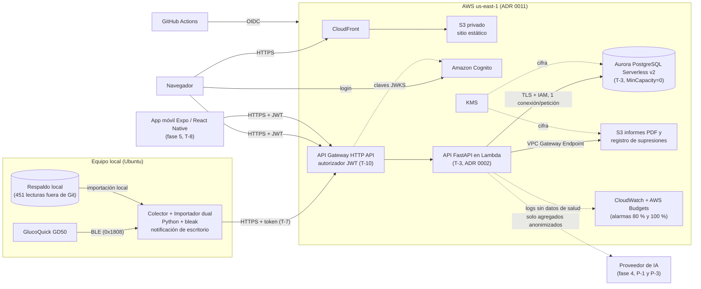

# Tecnología — monitorglucosa

> Estados: **Decidido** (aplícalo), **Propuesto** (recomendación pendiente de aprobar: no la
> implementes sin confirmación) y **Abierto** (ver [Decisiones abiertas](#decisiones-abiertas), IDs `T-n`).
> Región de referencia en AWS: **`us-east-1` (N. Virginia)** ([ADR 0011](../../docs/adr/0011-aws-region-us-east-1-for-cost-optimization.md)); la factura real valida `T-3`.

## Perfil de la carga de trabajo

Calibra la arquitectura. Ninguna sección siguiente debe pedir más complejidad de la que este perfil justifica, ni menos protección de la que exige (fuente: [discovery.md](discovery.md)).

| Dimensión | Valor *(Decidido)* |
| --- | --- |
| Proveedor / entorno | AWS, región exclusiva `us-east-1` (N. Virginia) ([ADR 0011](../../docs/adr/0011-aws-region-us-east-1-for-cost-optimization.md)) + colector BLE local en portátil Ubuntu |
| Criticidad | **Estándar** (uso personal y seguimiento crónico; no es un dispositivo de urgencia ni de soporte vital en tiempo real; jerarquía ante fallos: `Integridad > Pérdida > Filtración > Indisponibilidad`) |
| Datos | **Sensibles de salud** (Ley 1581/2012 Colombia como marco voluntario de buenas prácticas, art. 2 lit. a): glucemia, contexto BLE, dosis e inventario de insulina, anotaciones, patrones e informes |
| Usuarios y escala | **1 usuario** hoy y a 12 meses; `5 a 30 peticiones/min` en pico; volumen actual: 451 lecturas (`< 1 MB`); crecimiento MVP: `1 500–3 000` lecturas/año, `~1 100` dosis/año, `~1 200` movimientos de inventario/año, `250–500` anotaciones/año y `< 50 MB/año` (post-MVP con CGM `D-3`: `105 000–525 000` lecturas/año) |
| Objetivos de recuperación | **RTO ≤ 24 h** · **RPO operativo = 0 registros confirmados** en operación normal y **RPO ante desastre en AWS ≤ 24 h** (`R-4`, `R-5`) |
| Disponibilidad | Uso diario en sesiones cortas (1–3 veces/día) con **ventana crítica diaria de 20:00 a 23:00** (y madrugada en controles nocturnos) y **momento crítico anual 1–2 días antes de cada consulta médica**; sin soporte 24/7 (`R-2`) |

## Stack

| Capa | Tecnología | Estado | Motivo |
| --- | --- | --- | --- |
| Lenguaje | Python 3.13, fijada en `.python-version`; runtime `python3.13` de Lambda (retiro previsto por AWS: 2029-06-30) | **Decidido** | Stack principal del autor; ecosistema de datos y BLE (`PERF 1`, `PERF01-BP03`) |
| Backend | FastAPI | **Decidido** | Stack del autor (Platziflix); contrato OpenAPI automático |
| Contenedores | Docker Compose en `local` y CI: API, `postgres:16`, la web compilada servida con nginx y un emisor JWT de pruebas. El colector corre nativo con uv, porque necesita BLE y el keyring del SO | **Decidido** | Paridad entre máquinas; [ADR 0005](../../docs/adr/0005-containerized-local-environment.md) |
| Ejecución en Lambda | AWS Lambda Web Adapter (awslabs): la app corre con uvicorn, igual en local, en contenedor y en Lambda. Se despliega como imagen de contenedor desde Amazon ECR: la misma imagen que se prueba en local y en CI | **Decidido** | Sin código específico de Lambda; arranque en frío asumible (`R-6`) |
| Validación de entrada y salida | Pydantic (incluido con FastAPI) | **Decidido** | Esquemas estrictos en el borde y contrato OpenAPI |
| Base de datos | Aurora PostgreSQL 16, versión menor ≥ 16.4 (la auto-pausa exige una menor compatible); en local, `postgres:16` | **Decidido** | Stack del autor; datos relacionales con transacciones e integridad referencial |
| ORM y migraciones | SQLAlchemy + Alembic | **Decidido** | Migraciones reversibles, estándar en FastAPI |
| Gestor de dependencias | uv con lockfile | **Decidido** | Instalaciones reproducibles y rápidas |
| Frontend | Next.js exportado a estático; Node.js 24 LTS (confirmar al crear el frontend) | **Decidido** (`T-5`) | Stack del autor; sin funciones ni costes de servidor |
| Gráficas en la web | `Recharts` (licencia MIT) sobre React / Next.js | *Propuesto* (a confirmar en `fase-1c`) | Open Source permisiva (`US$0`), declarativa y ligera para series temporales y bloques horarios |
| Colector BLE e importador local | Python + `bleak` (BlueZ en Ubuntu), reutilizando el extractor RACP y el decodificador GLS ya probados localmente; `httpx` con timeouts explícitos y token según `T-7` | **Decidido** (`T-2`, `T-7`) | Un servidor en la nube no puede hablar BLE ([ADR 0001](../../docs/adr/0001-ble-collector-location.md)); incertidumbre técnica reducida a media |
| Notificaciones de escritorio | Capacidad nativa de Ubuntu (`notify-send` / libnotify) o librería Python multiplataforma `desktop-notifier` (MIT) invocada desde el colector | *Propuesto* (a confirmar en `fase-3`) | Coste `US$0`, sin demonios en segundo plano ni servicios externos |
| Generación de PDF | `fpdf2` (LGPLv3 / permisiva en Python puro) o `ReportLab` Open Source (BSD) en el backend, sin binarios nativos pesados (se descarta WeasyPrint/Chromium en Lambda por tamaño de imagen y memoria); PDF almacenado en S3 cifrado con KMS | *Propuesto* (a confirmar en `fase-2`) | Presupuesto de construcción `US$0`; compatible con la imagen ligera de Lambda |
| Exportación Excel (`.xlsx`) | `openpyxl` (licencia MIT) en el backend junto con la librería estándar `csv` para CSV | *Propuesto* (a confirmar en `fase-2`) | Estándar en Python para generar libros `.xlsx` en memoria sin coste ni SaaS externos |
| App móvil (fase 5) | Expo / React Native (TypeScript), cliente de la API; autenticación por validar | **Decidido** (`T-8`) | Un código para iOS y Android, coherente con el frontend; sin reglas de negocio |
| Cómputo y datos en nube | API en AWS Lambda detrás de API Gateway HTTP API (`T-10`) y Aurora PostgreSQL Serverless v2 con `MinCapacity` 0 y pausa tras 300 s, en **`us-east-1`** (`T-3`) | **Decidido** (`T-3`, `T-10`) | Escala a cero (`COST 6`, `COST06-BP01`, `SUS 2`, `SUS02-BP01`) y menores tarifas de lista en `us-east-1` ([ADR 0002](../../docs/adr/0002-serverless-compute-and-database.md), [ADR 0011](../../docs/adr/0011-aws-region-us-east-1-for-cost-optimization.md)) |
| Autenticación | Amazon Cognito, plan Essentials (coste con un usuario por verificar), para la web (MFA TOTP obligatorio); el colector usa un refresh token de Cognito guardado en el almacén seguro del SO | **Decidido** (`T-4`, `T-7`) | Datos sensibles con un solo usuario ([ADR 0003](../../docs/adr/0003-collector-authentication.md)) |
| Hosting del frontend | Next.js exportado como sitio estático en S3 + CloudFront (`T-5`). Dominios por defecto: `*.cloudfront.net` y el dominio de prefijo de Cognito; sin dominio propio ni ACM en el MVP | **Decidido** (`T-5`) | Sin funciones de servidor ni coste fijo de certificados/DNS (`SUS 5`, `SUS05-BP01`, `SUS05-BP03`) |
| IA e integraciones (fase 4) | Ver `T-6` | *Abierto (`T-6`)* | Depende de `P-1` y `P-3` |
| Infraestructura | AWS, región exclusiva `us-east-1` (N. Virginia) | **Decidido** | Optimización de coste bajo `< US$20/mes` y disponibilidad de servicios ([ADR 0011](../../docs/adr/0011-aws-region-us-east-1-for-cost-optimization.md), `SUS01-BP01`) |
| Infraestructura como código | Terraform; estado en S3 con `use_lockfile = true` | **Decidido** | Bloqueo nativo en S3, sin tabla DynamoDB (verificado en la documentación de Terraform) |
| Calidad | ruff, mypy en modo estricto, pytest (con marcador `@pytest.mark.req`), Hypothesis, import-linter | **Decidido** | Ver [Estándares de calidad](#estándares-de-calidad) |
| Calidad del frontend | TypeScript strict, ESLint (configuración de Next), Prettier, Vitest + Testing Library, tipos generados con openapi-typescript, npm con lockfile; Playwright solo para el flujo crítico (login → historial → gráfica) | **Decidido** | Cumplir la definición de hecho también en la web |
| Seguridad en CI | pre-commit (`gitleaks`, `ruff`, `mypy`, `kspec lint`), semgrep (reglas OWASP), escaneo de secretos y de dependencias | **Decidido** | Bloquea el commit y el merge si falla |
| CI/CD | GitHub Actions; AWS vía OIDC | **Decidido** | Sin claves de larga duración; repositorio en GitHub ([ADR 0008](../../docs/adr/0008-scoped-deployment-role-and-leak-free-pipeline.md)) |

## Comandos habituales

Comandos reales verificados hoy en `backend/pyproject.toml`, `.pre-commit-config.yaml` y `.cursor/kiro/bin/kspec` (los de `collector/`, `frontend/` e `infra/terraform/` se activan a medida que se creen sus carpetas en las tareas siguientes de `fase-1a` y `fase-1b`):

```bash
# Backend (ejecutar desde backend/)
uv sync --locked
uv run ruff check .
uv run ruff format --check .
uv run mypy src tests
uv run lint-imports
uv run pytest

# Hooks de pre-commit y calidad de specs / arquitectura (desde la raíz)
pre-commit run --all-files
python3 ~/.cursor/kiro/bin/kspec status
python3 ~/.cursor/kiro/bin/kspec steering check
python3 ~/.cursor/kiro/bin/kspec lint
python3 ~/.cursor/kiro/bin/kspec diagrams check

# Entorno local e infraestructura (provisionales hasta completar las tareas 11–22 de fase-1a)
docker compose up --build
terraform -chdir=infra/terraform fmt -check -recursive
terraform -chdir=infra/terraform validate
```

## Arquitectura

Estilo: Clean Architecture *(Decidido)*; reglas de dependencias en [structure.md](structure.md#regla-de-dependencias).
Las 10 vistas completas, generadas desde `docs/architecture/diagrams.py`, están en
[docs/architecture/README.md](../../docs/architecture/README.md). Resumen en texto:



| Componente | Responsabilidad | Estado |
| --- | --- | --- |
| Colector local e importador dual | Lee el GD50 por BLE o importa el archivo de respaldo local de las 451 lecturas, normaliza a UTC y mg/dL, aplica la clave de idempotencia (`T-9`), envía a la API y muestra avisos en el escritorio | **Decidido** (`T-2`, `T-7`) |
| API Gateway HTTP API | Valida el JWT de Cognito (firma, emisor, `aud` o `client_id`, expiración) y aplica throttling antes de invocar la API | **Decidido** (`T-10`) |
| API FastAPI | Valida entrada, ejecuta casos de uso (lecturas, insulina, inventario, anotaciones, alertas, análisis/patrones, informes PDF y exportaciones CSV/`.xlsx`) y expone `/api/v1`, `/health` y `/health/ready` | **Decidido** (`T-3`) |
| Aurora PostgreSQL Serverless v2 | Única fuente de verdad en la nube para lecturas, aplicaciones de insulina, movimientos de inventario, anotaciones, umbrales, avisos y patrones, con almacenamiento en 3 AZ y reemplazo automático de instancia (`REL 10`, `REL10-BP02`) | **Decidido** (`T-3`) |
| Sitio web (Next.js estático) | Interfaz en español (`< 3 clics y < 30 s` por acción habitual): historial, gráficas, registro de insulina e inventario, anotaciones, análisis/patrones, alertas y descargas | **Decidido** (`T-5`) |
| App móvil (fase 5) | Cliente de la API en Expo / React Native; sin acceso a BLE ni a la base de datos | **Decidido** (`T-8`); auth por validar en fase 5 |
| Amazon Cognito | Identidad de la web (MFA TOTP obligatorio) y del colector (refresh token con rotación) | **Decidido** (`T-4`, `T-7`) |
| S3 + CloudFront | Entrega del sitio estático; el bucket S3 es privado con Origin Access Control (OAC) | **Decidido** (`T-5`) |
| S3 de informes y supresiones | Almacena informes PDF generados y el registro de supresiones (8 días), cifrados con KMS y accedidos vía Gateway Endpoint de VPC | **Decidido** |
| CloudWatch, AWS Budgets y Parameter Store / Secrets Manager | Logs estructurados (30 días), métricas, alarmas operativas, alarmas de presupuesto (80 % = US$16 y 100 % = US$20) y configuración/secretos | **Decidido** |
| GitHub Actions | Calidad, seguridad, migraciones (`migrator` Lambda, [ADR 0006](../../docs/adr/0006-database-migrations-with-an-in-vpc-migrator-lambda.md)), bootstrap SQL ([ADR 0007](../../docs/adr/0007-idempotent-sql-bootstrap-through-rds-data-api.md)) y despliegue con Terraform | **Decidido** |

## Flujos críticos

### Autenticación del colector (T-7) *(Decidido)*

1. **Primer inicio de sesión:** el colector obtiene un código de autorización de Cognito con PKCE (S256) y lo canjea por tokens ([ADR 0003](../../docs/adr/0003-collector-authentication.md)). El navegador muestra el inicio de sesión de Cognito; el callback `http://localhost` (o esquema propio como alternativa) se valida en la spec de fase 1.
2. El refresh token se guarda exclusivamente en el almacén seguro del sistema operativo (`keyring`, p. ej. Secret Service en Linux). Nunca va al repositorio ni a archivos en texto claro.
3. Antes de cada sesión de sincronización, el colector canjea el refresh token por un access token de corta duración (60 min) mediante `GetTokensFromRefreshToken`, rotando el refresh token en cada canje con `RetryGracePeriodSeconds` configurado explícitamente en Terraform (plan Essentials de Cognito).
4. **Cierre de sesión y pérdida de equipo:** `RevokeToken` revoca el refresh token y los access tokens emitidos con él, y el colector lo borra del almacén local; si el equipo se pierde o se roba, `AdminUserGlobalSignOut` invalida los refresh tokens del usuario desde una sesión de administrador (los access tokens ya emitidos siguen siendo válidos hasta que expiran, ≤ 60 min).
5. **Reautenticación:** el refresh token dura **30 días**; la rotación no extiende ese plazo, así que cada 30 días se vuelve a iniciar sesión. No se usa el *device authorization grant* (no verificado en Cognito).

### Sincronización e importación dual de lecturas desde el GD50 *(Decidido, fase 1)*

1. El colector obtiene un access token vigente (ver *Autenticación del colector*) y soporta **dos orígenes de entrada** que pasan por el mismo pipeline de validación, normalización y clave de idempotencia (`T-9`):
   - **Lectura BLE en vivo** desde el GD50 (`0x1808` / RACP `0x2A52`), reutilizando el extractor RACP y el decodificador GLS probados en la investigación local.
   - **Importación desde el archivo de respaldo local** (que conserva los 451 registros históricos con `seq`, fecha/hora original, offset horario, valor, tipo/ubicación de muestra, banderas de control, contexto `0x2A34`, metadatos de calidad y tramas crudas/decodificadas).
2. Descarta registros con fecha o valor inválidos (el GD50 entregó uno con fecha 2038; `T-1`). Normaliza cada lectura a UTC y mg/dL: el estándar GLS envía kg/L (× 100 000) o mol/L (mmol/L × 18,016). Adjunta el contexto `0x2A34` excluyendo siempre el campo de medicación y marca como lectura de control las cuyo tipo o ubicación es «solución de control». La zona horaria del reloj interno se confirma con una medición de hora conocida (`T-1`).
3. Envía lotes de hasta 500 lecturas (`MAX_BATCH_SIZE`). Cada lectura lleva una clave de idempotencia derivada de sus datos (`T-9`). Si Aurora está en pausa y la API responde **503 `DATABASE_UNAVAILABLE`** con `Retry-After: 5` (o 5xx de gateway por superar los 30 s), el colector respeta el contrato de reintento hasta 60 s mostrando «despertando la base de datos» ([ADR 0009](../../docs/adr/0009-aurora-resume-as-a-retryable-503-within-30-seconds.md)).
4. La API inserta con una operación atómica que respeta la restricción `UNIQUE` de la clave (p. ej. `INSERT ... ON CONFLICT DO NOTHING`). Nunca «consultar y luego insertar»: dos peticiones concurrentes pasarían la consulta. Las lecturas ya existentes (por haberse importado antes desde el respaldo local o en una sincronización previa) se cuentan como ignoradas sin error (`RPO operativo = 0`).
5. Si la API responde 401 (access token vencido), el colector lo renueva con el refresh token y reintenta una vez. Si la API no responde por error transitorio de red, reintenta con backoff exponencial y jitter; no descarta lecturas.
6. El colector actualiza su contador local de sesiones iniciadas vs completadas (métrica 3) y guarda un registro local de las lecturas confirmadas para no reenviarlas. Solo contiene el hash de cada clave de idempotencia, nunca valores ni contexto médico. Ese registro es una optimización: la garantía contra duplicados es la restricción `UNIQUE` de la base de datos, así que perderlo solo provoca reenvíos inocuos.
7. Si el GD50 deja de responder a mitad de una sesión BLE, el colector termina limpiamente: lo confirmado queda guardado en Aurora y lo pendiente se leerá en la siguiente sesión.

### Registro manual de glucemia *(Decidido, fase 1)*

Usa el mismo caso de uso de registro con origen `manual`. Las lecturas manuales son editables y eliminables con confirmación explícita; su regla de duplicado se define en la spec `fase-1c`.

### Registro de insulina y recálculo automático del inventario *(Decidido, fases 2 y 3)*

1. El usuario registra una aplicación de insulina (en tiempo real o de forma **retroactiva** con la fecha y hora reales `administered_at` en que ocurrió) indicando tipo de insulina y unidades aplicadas (`< 3 clics y < 30 s`).
2. Dentro de una misma transacción en base de datos, el caso de uso guarda la aplicación de insulina y, cuando el inventario está activo (fase 3), registra el movimiento de consumo y descuenta las unidades del saldo disponible si `administered_at` es posterior al último ajuste por conteo físico (`T_conteo`).
3. Si el usuario **edita o elimina** (con confirmación explícita) una aplicación de insulina, el sistema recalcula automáticamente el saldo del inventario dentro de la misma transacción para las dosis con `administered_at > T_conteo`; las dosis retroactivas o editadas con `administered_at <= T_conteo` actualizan el historial y la estadística descriptiva (`a1+`) sin alterar ni duplicar descuentos sobre el saldo fijado en el conteo físico.
4. Para corregir desfases por olvidos o conteo físico de plumas/unidades en nevera, el usuario puede registrar un **ajuste manual de inventario** por conteo físico (`T_conteo`), que actúa como punto de corte contable (*checkpoint*) dejando trazabilidad completa del movimiento.

### Alertas y aviso por falta de medición *(Decidido, fase 3)*

- **Alertas de glucemia y de stock:** se evalúan al insertar o editar una lectura válida no duplicada (una lectura ignorada como duplicada no vuelve a evaluarse; una de control nunca se evalúa) o al actualizar el saldo del inventario. Las lecturas históricas también avisan y la notificación se agrupa por sincronización en la web y en el escritorio del colector (fase 3), WhatsApp (fase 4) y push en la app (fase 5).
- Como máximo un aviso por lectura y tipo de umbral; la restricción `UNIQUE` lo garantiza en la base de datos.
- Los umbrales son configurables por el usuario y sus valores iniciales provienen de una guía clínica citada con descargo visible hasta el cierre de `D-2` (`P-2`, `R4.1`).
- Si se edita o borra una lectura manual con aviso, el aviso se conserva marcado como «lectura corregida» o «lectura borrada»; si el valor editado cruza un umbral, se genera un aviso nuevo. *(Decidido)*
- **Aviso por falta de medición sincronizada:** se evalúa únicamente al abrir la aplicación web o al ejecutar una sincronización en el colector (sin procesos en segundo plano). Comprueba si existen lecturas almacenadas en las últimas 24 h (configurable en 12, 24, 48 h o personalizado); si no las hay, muestra el aviso «no hay lecturas sincronizadas en las últimas 24 h» con su descargo visible.
- El aviso informa; nunca recomienda tratamiento ni dosis ([ADR 0010](../../docs/adr/0010-descriptive-statistics-without-clinical-recommendations.md)).

### Despliegue y prueba de humo *(Decidido)*

Cubre lo que Docker no verifica, sin entorno de staging ([ADR 0005](../../docs/adr/0005-containerized-local-environment.md), [ADR 0006](../../docs/adr/0006-database-migrations-with-an-in-vpc-migrator-lambda.md), [ADR 0007](../../docs/adr/0007-idempotent-sql-bootstrap-through-rds-data-api.md), [ADR 0009](../../docs/adr/0009-aurora-resume-as-a-retryable-503-within-30-seconds.md), `OPS 6`, `OPS06-BP01`, `OPS06-BP04`):

1. GitHub Actions construye la imagen única de la API, la prueba con Docker Compose (linters, tipos, tests unitarios, de integración, de arquitectura y de propiedades) y la sube a ECR identificada por su digest.
2. Tras aprobación manual en el entorno `prod` de GitHub (fuera de la ventana crítica diaria de `20:00 a 23:00` COT), Terraform despliega ese digest en `us-east-1`, ejecuta el bootstrap SQL idempotente por RDS Data API y la Lambda `migrator` dentro de la VPC.
3. Prueba de humo (`scripts/smoke_test.py`), sin escribir datos: `/health/ready`, firmado con SigV4 por el rol OIDC del pipeline, responde 200 (reintentando los 503 de reanudación de Aurora hasta 120 s). Eso confirma API Gateway, Lambda, la VPC sin NAT, la autenticación IAM y la reanudación de Aurora. Además, un endpoint protegido sin token responde 401, lo que confirma que el autorizador JWT está activo.
4. Si la prueba falla, el despliegue se marca como fallido y se vuelve a desplegar automáticamente el digest anterior.

### App móvil (fase 5) *(Propuesto; tecnología decidida en `T-8`)*

- Consume la misma API (`/api/v1`) que la web. No accede a BLE ni a la base de datos.
- Autenticación propuesta: Cognito con PKCE en el almacén seguro de la plataforma, igual que el colector (`T-7`). Se valida en la spec de fase 5.
- Muestra el contenido informativo con las mismas reglas que las alertas y el análisis: descargo visible, sin diagnóstico ni dosis (`P-5`, [ADR 0010](../../docs/adr/0010-descriptive-statistics-without-clinical-recommendations.md)).

## Modelo de datos: invariantes *(Decidido)*

- **Jerarquía de integridad:** ningún dato corrupto, fuera de rango o con cálculo inconsistente se persiste ni se muestra como válido (`Integridad > Pérdida > Filtración > Indisponibilidad`). El rango válido de valores se define en la spec con una fuente clínica citada.
- **Zona horaria y unidades:** cada lectura guarda valor en mg/dL, instante en **UTC** y origen (`ble` o `manual`), y toda marca de tiempo (lecturas, dosis de insulina, movimientos de inventario, anotaciones y avisos) se almacena en **UTC**. La visualización, los informes PDF y los **seis bloques fijos de 4 horas** del motor de patrones (`00:00–03:59`, `04:00–07:59`, `08:00–11:59`, `12:00–15:59`, `16:00–19:59`, `20:00–23:59`) se evalúan en la **zona horaria configurada por el usuario** (por defecto `America/Bogota`, UTC−5).
- **Inmutabilidad vs mutabilidad con confirmación:**
  - Las lecturas `ble` (y las importadas del respaldo local del GD50) son **inmutables**. Pueden llevar contexto (`0x2A34`: comida, carbohidratos, ejercicio, salud; nunca medicación) y marca de control. Las de solución de control se guardan marcadas y no cuentan en historial general, estadísticas, patrones, alertas ni PDF.
  - Las lecturas `manual`, las **aplicaciones de insulina** y las **anotaciones** son editables y eliminables únicamente con confirmación explícita del usuario. No hay borrado físico sin confirmación explícita.
- **Separación estricta entre insulina y anotaciones (`Q-r`, `Q-p`):** las aplicaciones de insulina viven en su propia entidad y tabla; la categoría `medicación` de las anotaciones prohíbe registrar insulina para evitar duplicidades y descuadres en estadísticas (`a1+`) e inventario. En el MVP las anotaciones no tienen claves foráneas hacia patrones, alertas ni periodos comparados.
- **Consistencia transaccional e invariante de punto de corte (`T_conteo`) del inventario:** todo ajuste manual por conteo físico en el instante `T_conteo` actúa como punto de corte contable (*checkpoint*): el saldo actual suma compras posteriores y descuenta/recalcula únicamente las aplicaciones de insulina con `administered_at > T_conteo`, mientras que las dosis retroactivas, editadas o eliminadas con `administered_at <= T_conteo` actualizan el historial y la estadística `a1+` sin alterar el saldo posterior al conteo físico.
- **Unicidad garantizada por el motor (`UNIQUE`):** clave de idempotencia de lecturas (`T-9`) y par `(lectura, tipo de umbral)` en avisos, impuestas con restricciones `UNIQUE` en PostgreSQL y no solo en el código.

## Ciclo de vida de los datos

Detalle por entidad en la [vista de ciclo de vida](../../docs/architecture/svg/09-ciclo-de-vida-datos.svg) (`SUS 4`, `SUS04-BP03`, `SUS04-BP05`). *(Decidido)*

- **Retención e invalidación:** lecturas, contexto BLE, aplicaciones de insulina, movimientos de inventario, anotaciones, patrones y avisos se conservan en Aurora hasta que el titular los borre; los informes PDF se guardan en S3 sin expiración automática, incluyendo su marca de tiempo de generación y el hash de instantánea de los datos (si el usuario edita o elimina registros dentro del período de un PDF previo, dicho PDF se marca como obsoleto/invalidado y se regenera bajo demanda); logs en CloudWatch, 30 días; backups automáticos de Aurora, 7 días.
- **Entrega de informes y exportaciones:** las descargas de informes PDF y paquetes de exportación (CSV, `.xlsx` y PDF) se entregan al cliente mediante URL prefirmada de S3 de corta duración (`≤ 15 min`) y aplican el mismo contrato de reintento 503 ante reanudación de Aurora ([ADR 0009](../../docs/adr/0009-aurora-resume-as-a-retryable-503-within-30-seconds.md)).
- **Exportación total de salida:** antes de un borrado total o abandono del sistema, el titular puede exportar el 100 % de sus entidades (lecturas, insulina, inventario, anotaciones, patrones detectados e informes) en **CSV, Excel (`.xlsx`) y PDF**.
- **Supresión y registro de supresiones:** el borrado es inmediato en Aurora y S3 para todas las entidades seleccionadas. Los backups de Aurora conservan los bloques hasta que expiran (≤ 7 días); esa ventana se documenta y no se edita selectivamente. Un **registro de supresiones en S3** (fuera de Aurora, porque restaurar un backup anterior lo haría retroceder; expira a los 8 días = retención de backups + 1) guarda únicamente los hashes de las claves borradas y la fecha de cada borrado total, sin datos de salud, y se reaplica obligatoriamente tras cualquier restauración de backup antes de abrir el servicio.

## Requisitos no funcionales

| Atributo | Objetivo *(Decidido)* | Cómo se verifica |
| --- | --- | --- |
| Fiabilidad de sincronización | Ninguna lectura válida se pierde ni se duplica entre sesiones BLE ni al fusionar el respaldo local de 451 registros (`RPO operativo = 0`) | Prueba de integración y de propiedades con reintentos simulados e importación dual |
| Latencia de la API (`PERF 1`, `PERF01-BP03`) | `p95 < 500 ms` en el endpoint de historial con Aurora activa. Con Aurora en pausa (`MinCapacity = 0`), `connect_timeout = 20 s` y respuesta **503 `DATABASE_UNAVAILABLE`** con `Retry-After: 5`; los clientes reintentan hasta **60 s** mostrando «despertando la base de datos» (`smoke_test.py` hasta 120 s; [ADR 0009](../../docs/adr/0009-aurora-resume-as-a-retryable-503-within-30-seconds.md)) | Medición en el entorno `prod` y pruebas de integración con sondeador de base de datos |
| Usabilidad operativa | **< 3 clics y < 30 segundos** para cada acción habitual en la web (registrar una dosis de insulina, crear una anotación o consultar el historial) | Revisión de flujo en pruebas E2E (Playwright) y validación manual del titular |
| Disponibilidad | Servicio personal sin SLA 24/7 (`R-2`); se evitan despliegues o mantenimientos disruptivos en la ventana crítica diaria de **20:00 a 23:00** (hora de Colombia) y en las 48 h previas a consultas médicas | Regla operativa en `docs/runbooks/` y aprobación manual del despliegue en GitHub |
| Tamaño de entrada | Máximo 500 lecturas por lote (`MAX_BATCH_SIZE`); un lote mayor recibe 422 `READING_BATCH_TOO_LARGE` | Prueba unitaria de validación en el borde |
| Cuotas y límites (`REL 1`, `REL01-BP01`) | Throttling global en API Gateway HTTP API: **10 peticiones/s con ráfagas de 20**; concurrencia de Lambda y techo de ACUs de Aurora acotados en Terraform para proteger el presupuesto | Revisión de IaC (`infra/terraform/`) y prueba de humo |
| Recuperación y durabilidad (`REL 9`, `REL 13`) | **RTO ≤ 24 h**, **RPO operativo = 0 confirmados** y **RPO ante desastre en AWS ≤ 24 h** (`REL13-BP01`, `REL13-BP02`); backups automáticos de Aurora con 7 días de retención y recuperación a un punto en el tiempo (PITR) cifrados con KMS (`REL09-BP02`, `REL09-BP03`) y respaldo local inmutable de las 451 lecturas fuera de Git | Revisión de IaC y simulacro trimestral de restauración en la cuenta de `prod` (`REL09-BP04`, `REL13-BP03`): crear clúster temporal desde snapshot, reaplicar el registro de supresiones de S3, verificar integridad y destruir el clúster temporal (`docs/runbooks/`) |
| Coste (`COST 1`, `COST01-BP03`) | Operación en `us-east-1` **< US$20/mes**; dos alarmas en AWS Budgets: al **80 % (US$16/mes)** y al **100 % (US$20/mes)**; tope absoluto para una desviación puntual en un mes: **US$30/mes**; construcción: **US$0** | AWS Budgets en Terraform, cifras validadas en `T-3` ([ADR 0002](../../docs/adr/0002-serverless-compute-and-database.md), [ADR 0011](../../docs/adr/0011-aws-region-us-east-1-for-cost-optimization.md)) y runbook de respuesta a alarmas de coste |
| Sostenibilidad (`SUS01-BP01`, `SUS 2`, `SUS 4`, `SUS 5`) | Cero recursos ociosos permanentes (`SUS02-BP01`): región única `us-east-1` (`SUS01-BP01`), Aurora con `MinCapacity = 0` (auto-pausa a los 300 s), Lambda por petición, frontend estático en S3 + CloudFront (`SUS05-BP01`, `SUS05-BP03`), retención de logs de 30 días y backups de 7 días (`SUS04-BP03`, `SUS04-BP05`) | Revisión de IaC y verificación de auto-pausa en factura/métricas de CloudWatch |

## Entornos y configuración

| Entorno | Propósito | Datos |
| --- | --- | --- |
| `local` | Desarrollo con Docker Compose (API, PostgreSQL 16, web con nginx y emisor JWT de pruebas) | Datos sintéticos / ficticios (nunca reales) |
| `test` | Pruebas unitarias, de integración, contrato y propiedades en CI | PostgreSQL 16 real efímero en GitHub Actions, sin recursos en AWS; nunca datos reales |
| `prod` | Uso personal del titular en AWS `us-east-1` | Datos reales protegidos; protecciones: backups de 7 días y borrado protegido |

- **Sin entorno `staging` separado en AWS (`R-3`):** un único usuario y presupuesto `< US$20/mes`; la paridad se garantiza con la imagen única de contenedor en Docker Compose y el `smoke_test.py` post-despliegue ([ADR 0005](../../docs/adr/0005-containerized-local-environment.md)). Se revisa si el coste lo permite. *(Decidido)*
- Configuración solo por variables de entorno en `UPPER_SNAKE_CASE`, cargadas en una configuración tipada (`config.py` con `pydantic-settings`) que solo lee e inyecta `main.py`.
- **Secretos y KMS (`T-11`, *Decidido*):** RDS crea y rota la contraseña maestra de Aurora en Secrets Manager (`manage_master_user_password`, US$0,40/mes), sin que pase por Terraform ni por su estado; el cifrado en reposo usa claves KMS gestionadas por AWS (`aws/rds`, `aws/s3`, `aws/lambda`, `aws/secretsmanager`, US$0/mes de cuota fija). El resto de la configuración va en Parameter Store estándar; la Lambda no lo lee en ejecución, sino que recibe su configuración no secreta como variables de entorno al desplegar (`T-11`). En local, en un `.env` que nunca se commitea (está en `.gitignore`).
- Todos los recursos en la nube van etiquetados obligatoriamente con `Environment`, `Project` y `Owner` (`COST 3`, `COST03-BP02`, `COST03-BP05`) *(Decidido)*.

## Seguridad

- **Aislamiento de cuenta y credenciales raíz (`SEC 1`, `SEC01-BP01`, `SEC01-BP02`, `SEC01-BP07`):** cuenta de AWS dedicada en exclusiva a MonitorGlucosa; usuario raíz con MFA activo, sin claves de acceso (`access keys`) y con correo de recuperación y procedimiento de contingencia documentados por si se pierde el teléfono o el portátil. Modelo de amenazas STRIDE documentado en la [vista de flujo de datos y amenazas](../../docs/architecture/svg/08-flujo-de-datos.svg).
- **Datos sensibles (Ley 1581/2012, `SEC 7`, `SEC07-BP01`, `SEC07-BP02`, `SEC 8`, `SEC08-BP01`, `SEC08-BP02`, `SEC 9`, `SEC09-BP02`):** cifrado en reposo con claves KMS gestionadas por AWS para la base de datos Aurora, los snapshots y los objetos en S3 (sin coste fijo ni rotación manual; *Decidido*); TLS 1.2+ en todo el tráfico (incluyendo TLS + IAM hacia Aurora); sin datos de salud en logs, trazas ni mensajes de error.
- **Validación en el borde y errores 422 seguros:** validar todo input externo en el borde con esquemas Pydantic y límites explícitos (incluidas las lecturas del colector). Los errores de validación indican el campo y el problema, nunca el valor recibido: un manejador global propio reemplaza el 422 por defecto de FastAPI, que devuelve el campo `input`.
- **Acceso a datos y mínimo privilegio IAM (`SEC 2`):** SQL solo vía ORM o consultas parametrizadas (nunca concatenación de strings). IAM con mínimo privilegio: un rol por servicio, nunca `Action: "*"` ni `Resource: "*"` salvo las excepciones requeridas por AWS y documentadas con supresión con nombre en [ADR 0008](../../docs/adr/0008-scoped-deployment-role-and-leak-free-pipeline.md). Administración humana con credenciales temporales y MFA; GitHub Actions despliega mediante OIDC con el rol `monitorglucosa-deploy` acotado por *permissions boundary* y condición `aws:RequestedRegion = us-east-1` a `repo:ldordellygithub/monitorglucosa:environment:prod`.
- **Colector (`T-7`):** sin credenciales de AWS. Obtiene un access token de corta duración a partir de un refresh token en el almacén seguro del sistema operativo (`keyring`), con rotación y revocación ([ADR 0003](../../docs/adr/0003-collector-authentication.md)). Ante robo o pérdida del equipo: `RevokeToken` o `AdminUserGlobalSignOut`. Solo acepta la dirección BLE del GD50 registrada en el primer emparejamiento; si el enlace usa emparejamiento cifrado se verifica en `T-1` *(Decidido)*.
- **App móvil (fase 5, `T-8`):** el token se guarda solo en el almacén seguro de la plataforma; sin datos de salud en caché sin cifrar.
- **Autenticación por entorno ([ADR 0005](../../docs/adr/0005-containerized-local-environment.md)):** la API usa un puerto de autenticación con dos adaptadores, elegidos en `main.py`. En `prod` lee los claims que deja el autorizador JWT de API Gateway: Lambda Web Adapter entrega el contexto en la cabecera `x-amzn-request-context` (`requestContext.authorizer.jwt.claims`), siempre sobrescribiendo cualquier cabecera enviada por el cliente; si falta o no trae `sub`, la API rechaza la petición con 401. En `local` y `test`, el adaptador valida el JWT contra la JWKS del emisor de pruebas (`dev/jwt-issuer/`), y una prueba de CI garantiza que la configuración de `prod` rechaza ese emisor.
- **Controles detectivos y red dentro del presupuesto (`SEC 4`, `SEC04-BP01`):** CloudTrail gratuito (90 días), logs estructurados en CloudWatch (30 días, sin datos de salud), alarmas de errores 5xx/Lambda y alarmas de AWS Budgets al 80 % (US$16) y 100 % (US$20). VPC privada sin NAT Gateway ([ADR 0004](../../docs/adr/0004-api-network-without-nat.md)), Security Groups mínimos hacia el puerto 5432 de Aurora, acceso a S3 por VPC Gateway Endpoint y cabeceras HSTS/CSP/CORS en CloudFront. No se activan GuardDuty, Security Hub ni AWS WAF de pago mensual fijo para proteger `< US$20/mes` (`R-10`).
- **Doble barrera en repositorio público y respuesta a incidentes (`SEC 10`, `SEC10-BP02`, `SEC10-BP04`):** prohibido almacenar lecturas reales (incluidas las 451 del GD50), respaldos (`registros.csv`, `resumen.json`) o exportaciones (CSV, `.xlsx`, PDF) dentro del árbol del repositorio o en artefactos de CI; residen en rutas locales fuera del repositorio bajo cifrado de disco. Runbooks en `docs/runbooks/` para revocar tokens, atender alarmas de coste o errores y restaurar backups reaplicando supresiones.

## Observabilidad

- Logs estructurados en JSON (`OPS 8`, `OPS08-BP04`) con `correlation_id` por petición; prohibido registrar valores de glucemia, dosis de insulina, texto de anotaciones, tokens o secretos.
- Retención de logs en CloudWatch: **30 días** *(Decidido)*.
- Métricas mínimas *(Decidido)*: lecturas recibidas, ignoradas como duplicadas y rechazadas por validación; fallos de sincronización BLE; errores 5xx.
- Alarmas dirigidas al correo del titular: errores de invocación de Lambda, respuestas 5xx de API Gateway (vigilando que el 503 de reanudación de Aurora no genere ruido; [ADR 0009](../../docs/adr/0009-aurora-resume-as-a-retryable-503-within-30-seconds.md)) y alarmas presupuestarias en AWS Budgets al 80 % (US$16) y 100 % (US$20).
- `/health` responde 200 sin tocar la base de datos para no impedir la pausa automática de Aurora. `/health/ready` comprueba también la base de datos, exige autorización IAM y solo lo usa la prueba de humo (`scripts/smoke_test.py`). Ningún monitor externo llama a la API de forma periódica *(Decidido)*.

## Operación

- **Modelo operativo monousuario (`OPS 6`, `OPS 7`, `OPS07-BP02`, `OPS07-BP03`, `OPS07-BP04`):** operado por el titular en noches y fines de semana (`10 h/semana`, sin soporte 24/7; `R-1`, `R-2`). Antes de abrir el uso real en producción se completa la lista de preparación operativa en `docs/operations/readiness.md` y los procedimientos paso a paso en `docs/runbooks/` (despliegue y rollback, respuesta a alarma de presupuesto US$16/US$20/US$30, restauración trimestral de Aurora + registro de supresiones, y recuperación ante pérdida de portátil o teléfono).
- **Ventana de cambios y fiabilidad operativa (`REL 12`, `REL12-BP01`, `REL12-BP02`, `REL12-BP03`):** los despliegues a `prod` requieren aprobación manual en GitHub y se ejecutan fuera de la ventana crítica diaria (`20:00 a 23:00` COT) y fuera de las 48 h previas a una consulta médica.
- **Gestión de eventos y alertas (`OPS 10`, `OPS10-BP02`, `OPS10-BP04`):** cada alarma de presupuesto o fallo de despliegue/sincronización tiene procedimiento accionable en `docs/runbooks/`, se revisa con análisis post-incidente ligero y actualiza las pruebas o el runbook correspondiente.

## Estándares de calidad

- **Trazabilidad de requisitos a pruebas:** cada prueba que verifica un criterio EARS lleva el marcador `@pytest.mark.req("<spec>#<X.Y>")` (registrado en `backend/pyproject.toml`) y se valida con `kspec trace check`.
- **Pruebas y cobertura:** pytest + Hypothesis (pruebas basadas en propiedades para invariantes de dominio, agregados `a1+`, inventario y deduplicación). Cobertura **≥ 80 %** en el dominio y los casos de uso (`domain` y `application`) *(Decidido)*. Nombres `test_<función>_<escenario>_<resultado>`, estructura Arrange → Act → Assert.
- **Servicios externos:** siempre simulados con fakes en pruebas unitarias. El BLE del GD50 (`bleak`) y el archivo de respaldo local se simulan con adaptadores falsos.
- **Integración:** contra PostgreSQL 16 real de prueba, nunca mocks del ORM.
- **Contrato:** el cliente del colector, la web y la app móvil se validan contra el esquema OpenAPI versionado (`backend/openapi.json`) que genera FastAPI *(Decidido)*.
- **Lint, formato, tipos y arquitectura:** `ruff`, `mypy` en modo estricto e `import-linter` en Python; TypeScript strict, ESLint y Prettier en la web *(Decidido)*.
- **Migraciones:** reversibles (`downgrade()` obligatorio) y probadas en `test` antes de aplicarse en `prod`.

## Restricciones

- Presupuesto mensual ordinario de nube en AWS (`us-east-1`) **< US$20/mes** (alarmas al 80 % = US$16 y al 100 % = US$20; tope absoluto puntual de US$30/mes) y presupuesto de construcción **US$0** adicionales (solo herramientas Open Source con licencias permisivas y GitHub Free). *(Decidido)*
- Región exclusiva en la nube: **`us-east-1` (N. Virginia)** ([ADR 0011](../../docs/adr/0011-aws-region-us-east-1-for-cost-optimization.md)). Ningún dato de salud se almacena ni se procesa fuera de `us-east-1`, salvo los agregados anonimizados de `P-3` si una integración de la fase 4 lo requiere. Lo que el titular descarga (PDF, CSV, `.xlsx`) o ve en su navegador o app queda bajo su control exclusivo. *(Decidido)*
- Ninguna infraestructura se crea a mano: todo pasa por Terraform (`infra/terraform/`). *(Decidido)*
- Sin claves de AWS ni secretos ni datos reales de salud (incluidas las 451 lecturas del GD50) en el repositorio público, en artefactos de CI ni en el colector. *(Decidido)*
- Los clientes (colector, web y futura app móvil) acceden a los datos solo a través de la API (`/api/v1`). *(Decidido)*

## Riesgos aceptados

Riesgos asumidos conscientemente por el titular en el descubrimiento (bloque 8 de [discovery.md](discovery.md)) y en la revisión Well-Architected para respetar el presupuesto de `< US$20/mes` y la dedicación de un único ingeniero.

| ID | Riesgo | Nivel | Motivo por el que se acepta | Cuándo revisar |
| --- | --- | --- | --- | --- |
| R-1 | Factor bus = 1 y operador único | Alto | Desarrollo, operación y administración dependen exclusivamente del titular (`R4.2b`); mitigado con procedimientos documentados de recuperación de cuentas/MFA (AWS y GitHub), exportaciones periódicas y el GD50 físico | Si el proyecto pasa a tener más de un usuario o un segundo operador |
| R-2 | Ausencia de soporte 24/7 | Medio | El titular atiende incidencias y despliegues en noches, fines de semana y tiempo libre; no es un sistema de urgencia médica en tiempo real | Si cambia la criticidad de la carga o se integra monitoreo continuo |
| R-3 | Sin entorno `staging` en AWS | Medio | Mantener un segundo entorno en AWS duplicaría gestión y costes bajo `< US$20/mes`; mitigado con Docker Compose idéntico a Lambda y `smoke_test.py` ([ADR 0005](../../docs/adr/0005-containerized-local-environment.md)) | Si la factura en `us-east-1` deja holgura y aparecen fallos no capturados en local |
| R-4 | `RTO ≤ 24 h` e instancia única de cómputo en Aurora (`REL 10`) | Medio | Se usa una sola instancia Serverless v2 con almacenamiento en 3 AZ y reemplazo automático (`REL10-BP02`), descartando réplica lectora y despliegue multirregión por coste (`REL10-BP01`) | Si una caída real supera 24 h o sube el presupuesto |
| R-5 | `RPO ≤ 24 h` ante desastre en AWS (altas y ediciones in-place de las últimas 24 h) | Medio | Aunque el RPO operativo es 0 registros confirmados, no se replica a otra región para proteger `< US$20/mes`; mitigado por snapshots diarios de 7 días, reaplicación del registro de supresiones de S3, el búfer del GD50 y los respaldos locales | Al integrar ingesta continua de CGM en fase 4 (`D-3`) |
| R-6 | *Cold starts* de Aurora Serverless v2 (~15–35 s tras pausa) | Medio | El rendimiento es la primera dimensión que se sacrifica para ahorrar ~US$40–42/mes en `us-east-1` con `MinCapacity = 0` ([ADR 0002](../../docs/adr/0002-serverless-compute-and-database.md), [ADR 0011](../../docs/adr/0011-aws-region-us-east-1-for-cost-optimization.md)); mitigado con el contrato 503 reintentable ([ADR 0009](../../docs/adr/0009-aurora-resume-as-a-retryable-503-within-30-seconds.md)) | Si en el uso diario los reintentos superan 60 s de forma recurrente |
| R-7 | Sincronización BLE manual en lote | Medio | Exige acercar el GD50 al portátil y ejecutar el colector cada 2–3 días; se descartó un demonio en segundo plano para reducir complejidad en el MVP, mientras el GD50 conserva las lecturas entre sesiones | Al diseñar la fase 4 (CGM) o la fase 5 (app móvil) |
| R-8 | Avisos diferidos (solo al sincronizar o abrir la web) | Medio | En el MVP no hay notificaciones push ni WhatsApp para no añadir infraestructura móvil ni terceros procesando datos de salud (`P-3`, `T-8`) | Al iniciar las fases 4 y 5 |
| R-9 | Falsos positivos temporales del aviso de «24 h sin lecturas sincronizadas» al viajar sin portátil | Medio | Consecuencia de evaluar solo las lecturas sincronizadas cuando el titular viaja sin portátil pero se mide en el GD50; mitigado con el texto explícito del aviso (`R2.7`) | Cuando exista sincronización desde app móvil (fase 5) |
| R-10 | Sin GuardDuty, Security Hub ni AWS WAF de pago mensual fijo | Medio | Se descartan servicios de seguridad con cuota fija mensual para proteger `< US$20/mes`, confiando en CloudTrail gratuito (90 días), autorizador JWT + throttling en API Gateway, VPC sin NAT y alarmas en CloudWatch/Budgets | Si la factura mensual se desvía o el sistema se abre a terceros |

## Cobertura Well-Architected

Revisión de los 6 pilares de AWS Well-Architected calibrada al perfil de la carga (`Estándar`, `Sensibles de salud`, 1 usuario, `< US$20/mes`).

| Pilar | Prácticas aplicadas y sección donde se concretan | Riesgos o descartes registrados |
| --- | --- | --- |
| Excelencia operativa | Prioridades de negocio y trade-offs en [discovery.md](discovery.md); despliegue por digest, prueba de humo y rollback automático en [Flujos críticos](#flujos-críticos) (`OPS 6`, `OPS06-BP01`, `OPS06-BP04`); lista de preparación operativa en `docs/operations/readiness.md` (`OPS07-BP02`) y runbooks en `docs/runbooks/` (`OPS 7`, `OPS07-BP03`, `OPS07-BP04`); logs JSON estructurados y alarmas accionables en [Observabilidad](#observabilidad) (`OPS 8`, `OPS08-BP04`); gestión de eventos y alertas en [Operación](#operación) (`OPS 10`, `OPS10-BP02`, `OPS10-BP04`) | Operador único con factor bus = 1 (`R-1`), sin soporte 24/7 (`R-2`) y sin entorno `staging` en AWS (`R-3`) |
| Seguridad | Cuenta AWS dedicada, root con MFA sin claves y modelo STRIDE en el diagrama de flujo de datos (`SEC 1`, `SEC01-BP01`, `SEC01-BP02`, `SEC01-BP07`); Cognito MFA TOTP, `keyring` con rotación y OIDC acotado por *permissions boundary* (`SEC 2`); CloudTrail gratuito (90 días), logs sin datos de salud y alarmas en CloudWatch/Budgets (`SEC 4`, `SEC04-BP01`); clasificación de datos sensibles de salud (`SEC 7`, `SEC07-BP01`, `SEC07-BP02`); KMS en reposo más respaldo local cifrado fuera de Git (`SEC 8`, `SEC08-BP01`, `SEC08-BP02`) y TLS + IAM en tránsito (`SEC 9`, `SEC09-BP02`); playbooks de revocación y respuesta en `docs/runbooks/` (`SEC 10`, `SEC10-BP02`, `SEC10-BP04`). Ver [Seguridad](#seguridad) | Sin GuardDuty, Security Hub ni AWS WAF de coste fijo mensual para proteger `< US$20/mes` (`R-10`) |
| Fiabilidad | Throttling y cuotas acotadas (`REL 1`, `REL01-BP01`); backups cifrados de 7 días con PITR, simulacro trimestral de restauración y registro de supresiones en S3 (`REL 9`, `REL09-BP02`, `REL09-BP03`, `REL09-BP04`); almacenamiento de Aurora en 3 AZ con recuperación automática de instancia en una sola región (`REL 10`, `REL10-BP02`); playbooks operativos y ventana protegida 20:00–23:00 (`REL 12`, `REL12-BP01`, `REL12-BP02`, `REL12-BP03`); objetivos y pruebas de DR (`REL 13`, `REL13-BP01`, `REL13-BP02`, `REL13-BP03`). Ver [Flujos críticos](#flujos-críticos) y [Requisitos no funcionales](#requisitos-no-funcionales) | `RTO ≤ 24 h` sin despliegue multirregión (`REL10-BP01` descartado, `R-4`) y `RPO ≤ 24 h` ante desastre en AWS (`R-5`) |
| Eficiencia del rendimiento | Selección de arquitectura serverless gestionada justificada por coste y escala de 1 usuario, `p95 < 500 ms` en caliente y contrato 503 reintentable con `Retry-After` ([ADR 0009](../../docs/adr/0009-aurora-resume-as-a-retryable-503-within-30-seconds.md), `PERF 1`, `PERF01-BP03`). Ver [Stack](#stack) y [Requisitos no funcionales](#requisitos-no-funcionales) | Se sacrifican los *cold starts* de ~15–35 s tras pausa de Aurora a cambio de escala a cero (`R-6`) |
| Optimización de costos | Presupuesto `< US$20/mes`, alarmas en AWS Budgets al 80 % (US$16) y 100 % (US$20) y tope puntual de US$30/mes (`COST 1`, `COST01-BP03`); etiquetas `Environment`, `Project`, `Owner` y seguimiento en Cost Explorer (`COST 3`, `COST03-BP02`, `COST03-BP05`); dimensionamiento con escala a cero (`MinCapacity = 0`), sin NAT Gateway y en la región de menor tarifa `us-east-1` (`COST 6`, `COST06-BP01`, [ADR 0011](../../docs/adr/0011-aws-region-us-east-1-for-cost-optimization.md)). Ver [Requisitos no funcionales](#requisitos-no-funcionales) | Ninguno: el coste es la prioridad más protegida del proyecto |
| Sostenibilidad | Región `us-east-1` elegida según requisitos y eficiencia (`SUS01-BP01`); escala a cero real sin recursos ociosos (`SUS 2`, `SUS02-BP01`); ciclo de vida y expiración automática de logs (30 días), backups (7 días) y registro de supresiones (8 días) (`SUS 4`, `SUS04-BP03`, `SUS04-BP05`); servicios gestionados y web estática (`SUS 5`, `SUS05-BP01`, `SUS05-BP03`). Ver [Ciclo de vida de los datos](#ciclo-de-vida-de-los-datos) | Ninguno para la escala de un único usuario |

## Decisiones abiertas

| ID | Pregunta | Estado | Resolución o pendiente | Bloquea |
| --- | --- | --- | --- | --- |
| T-1 | ¿El GD50 expone un servicio BLE estándar (Glucose Profile, `0x1808`) o un protocolo propietario? ¿Qué zona horaria, reloj y tope de memoria usa? | **Resultado parcial** (`bleak` en Ubuntu, incertidumbre media) | GATT de solo lectura y lectura RACP hechos en la investigación local, sin borrar: `0x1808` expone `0x2A18`, `0x2A34`, `0x2A51` y `0x2A52` (no expone Date Time ni Current Time; `0x1523` plantilla Nordic sin uso confirmado), RACP devolvió 451 registros (450 válidos y 1 con fecha 2038), descartando un protocolo propietario frente al estándar Bluetooth. Pendiente de cerrar en vivo antes de `fase-1b`: (1) confirmar en el manual o con el fabricante el tope de memoria y la sobrescritura circular, (2) confirmar la zona horaria del reloj interno con una medición de hora conocida, y (3) verificar si el enlace usa emparejamiento cifrado (bonding). Escribir en RACP requiere aprobación; nunca enviar el comando RACP de borrado (`0x06`). Si algo no sigue el estándar, se registra ADR. | Fase 1 (`fase-1b`, diseño del colector) |
| T-2 | ¿Dónde corre la lectura BLE? | **Decidido** | Colector Python con `bleak` en el equipo local. Web Bluetooth descartado: solo funciona en Chromium, exige HTTPS y gesto del usuario, y no funciona en Firefox ni Safari. `bleak` usa BlueZ en Linux y soporta notificaciones GATT ([ADR 0001](../../docs/adr/0001-ble-collector-location.md)). | Ninguno (resuelto) |
| T-3 | ¿Qué cómputo y base de datos caben en `< US$20/mes` en `us-east-1`? | **Decidido** (A1 en `us-east-1`) | API en Lambda + Aurora PostgreSQL Serverless v2 (`MinCapacity = 0`, auto-pausa a los 300 s, versión ≥ 16.4) en **`us-east-1`** ([ADR 0002](../../docs/adr/0002-serverless-compute-and-database.md), [ADR 0009](../../docs/adr/0009-aurora-resume-as-a-retryable-503-within-30-seconds.md), [ADR 0011](../../docs/adr/0011-aws-region-us-east-1-for-cost-optimization.md)). En `us-east-1` (US$0,12/ACU-h y US$0,10/GB-mes), el uso bajo con escala a cero más Secrets Manager (US$0,40/mes) y claves KMS gestionadas por AWS (US$0/mes fijo) ronda ≈ US$2–4/mes; sin escala a cero (0,5 ACU continuos) costaría ≈ US$43,80/mes (≈ US$91,25/mes en `sa-east-1`), por lo que `MinCapacity = 0` es obligatorio; techo del presupuesto ≈ 150 ACU-h/mes en `us-east-1`. Se descartaron `sa-east-1`, A2 (instancia fija) y BD local. Pendiente: validar con la primera factura real y las alarmas de US$16 y US$20. | Despliegue en nube (`fase-1a`) |
| T-4 | ¿Cómo se autentica el usuario en la web y el colector? | **Decidido** | Web: Amazon Cognito con MFA TOTP obligatorio. Colector: refresh token de Cognito según `T-7`. Descartado el token estático local. | Despliegue en nube (`fase-1a`) |
| T-5 | ¿Cómo se sirve el frontend? | **Decidido** | Next.js exportado como sitio estático en S3 + CloudFront. Sin SSR, rutas de servidor ni server actions. | Ninguno (resuelto) |
| T-6 | ¿Qué proveedor y framework de IA se usan en la fase 4? | **Abierto** | Pospuesto a la fase 4 (post-MVP) y sujeto a `P-1` y `P-3`: el análisis estadístico descriptivo (`a1+`) y los patrones del MVP se resuelven con reglas deterministas en Python en vez de llamar a un LLM externo, descartando costes e integraciones de terceros en las fases 1–3. En la fase 4 se evaluará Amazon Bedrock vs API externa sobre agregados anonimizados. | Fase 4 |
| T-7 | ¿Cómo obtiene el colector un token sin credenciales de larga duración? | **Decidido** | Refresh token de Cognito en el almacén seguro del SO (`keyring`), con rotación (`GetTokensFromRefreshToken`, `RetryGracePeriodSeconds`) y revocación (`RevokeToken`). Autorización con código y PKCE (S256). Plan Essentials; duración de 30 días sin extensión por rotación. Pendiente en la spec de fase 1: validar el callback `http://localhost` (alternativa: esquema propio). Descartado el secreto local (client credentials). [ADR 0003](../../docs/adr/0003-collector-authentication.md). | Ninguno (resuelto); validación del callback en fase 1 |
| T-8 | ¿Qué tecnología y autenticación tiene la app móvil (fase 5)? | **Tecnología decidida**; autenticación por validar | Expo / React Native (TypeScript) elegido frente a desarrollo nativo separado para iOS y Android, como cliente de la API sin reglas de negocio. Autenticación propuesta: Cognito con PKCE en el almacén seguro de la plataforma (como `T-7`), descartando guardar tokens en almacenamiento plano; se valida en la spec de fase 5. Apple Health requiere acceso nativo a iOS: reevaluar en fase 5 si aplica. | Fase 5 (autenticación móvil) |
| T-9 | ¿Qué clave de idempotencia identifica cada lectura del GD50 (por BLE o desde el respaldo local) sin colisiones? | **Abierto** | En los 451 registros extraídos existen 4 marcas de tiempo con múltiples lecturas distintas en el mismo minuto (p. ej. 7 registros en `2026-03-19 02:43`), por lo que se descartó la clave simple «dispositivo + instante UTC + origen» (que descartaría lecturas reales) frente a una clave compuesta que incluya el número de secuencia (`seq`, que parece posicional) o una huella determinista de los campos GLS (`seq + timestamp original + valor + tipo/ubicación`). Pendiente de verificar la estabilidad de `seq` tras una medición nueva en el GD50 y cerrar la fórmula con Luis antes de `fase-1b`. | Fase 1 (`fase-1b`, sincronización e importación dual) |
| T-10 | ¿Cómo llega la API a Aurora sin NAT Gateway y sin impedir la pausa? | **Decidido** | API Gateway HTTP API con autorizador JWT de Cognito delante de Lambda. Lambda en la VPC privada, sin NAT: conecta a Aurora por TLS con autenticación IAM (token firmado localmente) y abre y cierra una conexión por petición; sin pool persistente ni RDS Proxy, que impiden la pausa automática (verificado en AWS). S3 por VPC Gateway Endpoint. Descartados: NAT Gateway (US$0,045/h ≈ US$32,85/mes en `us-east-1`) y RDS Data API para tráfico de la API (acopla los repositorios a AWS y no se prueba con PostgreSQL real). La fase 4 define su propia salida a internet. [ADR 0004](../../docs/adr/0004-api-network-without-nat.md), [ADR 0011](../../docs/adr/0011-aws-region-us-east-1-for-cost-optimization.md). | Despliegue en nube (`fase-1a`) |
| T-11 | ¿Cómo recibe la Lambda su configuración sin salida a internet? | **Decidido** | Terraform lee Parameter Store en el despliegue y la inyecta como variables de entorno de la Lambda, cifradas en reposo con la clave KMS gestionada por AWS. Nunca contienen secretos: quien tenga `lambda:GetFunctionConfiguration` las ve. En la fase 1 la API no necesita secretos en ejecución (Aurora por IAM, JWT en API Gateway, secreto maestro solo desde RDS Data API en el pipeline según [ADR 0007](../../docs/adr/0007-idempotent-sql-bootstrap-through-rds-data-api.md)); los de la fase 4 se resuelven con su salida a internet. Descartado: endpoint de interfaz de SSM (US$0,01/h por AZ ≈ US$14,60/mes con 2 AZs en `us-east-1`). [ADR 0004](../../docs/adr/0004-api-network-without-nat.md). | Despliegue en nube (`fase-1a`) |
