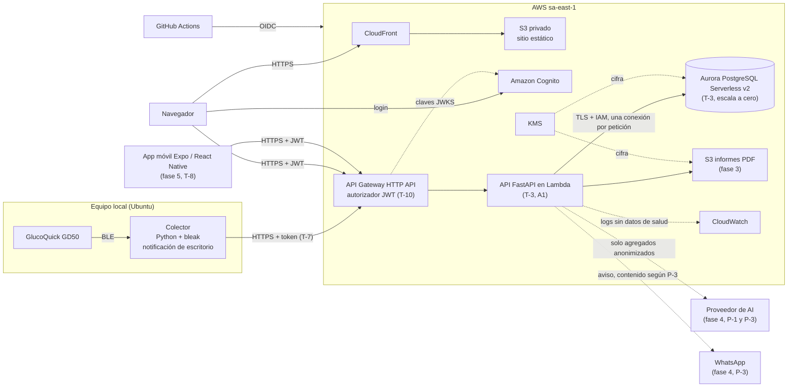

# Tecnología — monitorglucosa

> Estados: **Decidido** (aplícalo), **Propuesto** (recomendación pendiente de aprobar: no la
> implementes sin confirmación) y **Abierto** (ver [Decisiones abiertas](#decisiones-abiertas), IDs `T-n`).
> Precios: lista pública de AWS para `sa-east-1` (instantánea 2026-10-31); la factura real valida `T-3`.

## Stack

| Capa | Tecnología | Estado | Motivo |
| --- | --- | --- | --- |
| Lenguaje | Python 3.13, fijada en `.python-version`; runtime `python3.13` de Lambda (retiro previsto por AWS: 2029-06-30) | **Decidido** | Stack principal del autor; ecosistema de datos y BLE |
| Backend | FastAPI | **Decidido** | Stack del autor (Platziflix) |
| Contenedores | Docker Compose en `local` y CI: API, `postgres:16`, la web compilada servida con nginx y un emisor JWT de pruebas. El colector corre nativo con uv, porque necesita BLE y el keyring del SO | **Decidido** | Paridad entre máquinas; [ADR 0005](../../docs/adr/0005-containerized-local-environment.md) |
| Ejecución en Lambda | AWS Lambda Web Adapter (awslabs): la app corre con uvicorn, igual en local, en contenedor y en Lambda. Se despliega como imagen de contenedor desde Amazon ECR: la misma imagen que se prueba en local y en CI | **Decidido** | Sin código específico de Lambda; algo más de arranque en frío |
| Validación de entrada y salida | Pydantic (incluido con FastAPI) | **Decidido** | Esquemas en el borde y contrato OpenAPI |
| Base de datos | Aurora PostgreSQL 16, versión menor ≥ 16.4 (la auto-pausa exige una menor compatible); en local, `postgres:16` | **Decidido** | Stack del autor; datos relacionales con series temporales simples |
| ORM y migraciones | SQLAlchemy + Alembic | **Decidido** | Migraciones reversibles, estándar en FastAPI |
| Gestor de dependencias | uv con lockfile | **Decidido** | Instalaciones reproducibles y rápidas |
| Frontend | Next.js exportado a estático; Node.js 24 LTS (confirmar al crear el frontend) | **Decidido** (`T-5`) | Stack del autor; sin funciones de servidor |
| Colector BLE | Python + `bleak` (BlueZ en Ubuntu), httpx con timeouts explícitos y token según `T-7` | **Decidido** (`T-2`, `T-7`) | Un servidor en la nube no puede hablar BLE |
| App móvil (fase 5) | Expo / React Native (TypeScript), cliente de la API; autenticación por validar | **Decidido** (`T-8`) | Un código para iOS y Android, coherente con el frontend; sin reglas de negocio |
| Cómputo y datos en nube | API en AWS Lambda detrás de API Gateway HTTP API (`T-10`) y Aurora PostgreSQL Serverless v2 con `MinCapacity` 0 y pausa tras 300 s, en `sa-east-1` (A1, `T-3`) | **Decidido** (`T-3`, `T-10`) | Escala a cero; coste estimado dentro de US$20/mes con uso bajo, a validar con factura |
| Autenticación | Amazon Cognito, plan Essentials (coste con un usuario por verificar), para la web (MFA TOTP obligatorio); el colector usa un refresh token de Cognito guardado en el almacén seguro del SO | **Decidido** (`T-4`, `T-7`) | Datos sensibles con un solo usuario |
| Hosting del frontend | Next.js exportado como sitio estático en S3 + CloudFront (`T-5`). Dominios por defecto: `*.cloudfront.net` y el dominio de prefijo de Cognito; sin dominio propio ni ACM en el MVP | **Decidido** (`T-5`) | Sin funciones de servidor |
| Generación de PDF | Por decidir en la spec de la fase 3 | *Abierto* (spec de fase 3) | Librería a elegir en esa spec; PDF cifrado con KMS |
| IA y integraciones | Ver `T-6` | *Abierto (`T-6`)* | Depende de `P-1` y `P-3` |
| Infraestructura | AWS, región `sa-east-1` | **Decidido** | Región más cercana a Colombia |
| Infraestructura como código | Terraform; estado en S3 con `use_lockfile = true` | **Decidido** | Bloqueo nativo en S3, sin tabla DynamoDB (verificado en la documentación de Terraform) |
| Calidad | ruff, mypy en modo estricto, pytest | **Decidido** | Ver [Estándares de calidad](#estándares-de-calidad) |
| Calidad del frontend | TypeScript strict, ESLint (configuración de Next), Prettier, Vitest + Testing Library, tipos generados con openapi-typescript, npm con lockfile; Playwright solo para el flujo crítico (login → historial → gráfica). Versiones fijadas en la spec | **Decidido** | Cumplir la definición de hecho también en la web |
| Seguridad en CI | semgrep (reglas OWASP), escaneo de secretos y de dependencias | **Decidido** | Bloquea el merge si falla |
| CI/CD | GitHub Actions; AWS vía OIDC | **Decidido** | Sin claves de larga duración; repositorio en GitHub |

## Comandos habituales

> Aún no hay comandos: el repositorio solo contiene configuración de Kiro y `.gitignore`.
> Esta sección se completa cuando existan `pyproject.toml`, `Makefile` o scripts equivalentes. No inventes otros.

## Arquitectura

Estilo: Clean Architecture *(Decidido)*; reglas de dependencias en [structure.md](structure.md#regla-de-dependencias).
Las 10 vistas completas, generadas desde `docs/architecture/diagrams.py`, están en
[docs/architecture/README.md](../../docs/architecture/README.md). Resumen en texto:

| Componente | Responsabilidad | Estado |
| --- | --- | --- |
| Colector local | Lee el GD50 por BLE, normaliza las lecturas y las envía a la API con su token | **Decidido** (`T-2`, `T-7`) |
| API Gateway HTTP API | Valida el JWT de Cognito (firma, emisor, `aud` o `client_id`, expiración) antes de invocar la API | **Decidido** (`T-10`) |
| API FastAPI | Valida entrada, ejecuta casos de uso (registro, deduplicación, alertas, informes) y expone `/api/v1` y `/health` | **Decidido** (stack y Lambda, `T-3`) |
| PostgreSQL | Única fuente de verdad de lecturas, umbrales y alertas | **Decidido** (motor y Aurora Serverless v2, `T-3`) |
| Sitio web | Interfaz en español: historial, gráfica, registro manual y umbrales | **Decidido** (`T-5`) |
| App móvil | Consulta el historial, registra mediciones y muestra contenido informativo, todo vía API; sin acceso a BLE ni a la base de datos | **Decidido** (Expo / React Native, `T-8`); autenticación por validar en fase 5 |
| Amazon Cognito | Identidad de la web y del colector; la API valida sus tokens. La app móvil se confirma en `T-8` | **Decidido** (`T-4`, `T-7`) |
| S3 + CloudFront | Entrega del sitio estático; el bucket no es público | **Decidido** (`T-5`) |
| S3 de informes | PDF de la fase 3 (sin expiración) y registro de supresiones (8 días), cifrados con KMS | **Decidido** |
| CloudWatch, AWS Budgets y Parameter Store | Logs, métricas, alarmas, presupuesto y secretos | **Decidido** |
| GitHub Actions | Lint, tipos, pruebas, seguridad y despliegue con Terraform | **Decidido** |

## Flujos críticos

### Autenticación del colector (T-7) *(Decidido)*

1. **Primer inicio de sesión:** el colector obtiene un código de autorización de Cognito con PKCE (S256) y lo canjea por tokens. El callback `http://localhost` queda por validar en la spec de fase 1, porque AWS lo documenta solo para pruebas. Si no es aceptable, se usa un esquema de redirección propio.
2. El refresh token se guarda en el almacén seguro del sistema operativo. Nunca va al repositorio ni a un archivo de configuración.
3. Antes de cada sesión BLE, el colector canjea el refresh token por un access token de corta duración (60 minutos por defecto en Cognito).
4. Con la rotación activada (exige el plan Essentials o Plus de Cognito, no Lite), el colector canjea con `GetTokensFromRefreshToken`, porque `REFRESH_TOKEN_AUTH` no admite rotación. Cada canje devuelve un refresh token nuevo e invalida el anterior tras el periodo de gracia `RetryGracePeriodSeconds` (0–60 s; si no se fija vale 0, así que Terraform lo fija explícitamente). El colector guarda el nuevo de inmediato.
5. **Cierre de sesión:** `RevokeToken` revoca el refresh token y los access tokens emitidos con él. No requiere credenciales de IAM.
6. **Equipo perdido:** `AdminUserGlobalSignOut` invalida los tokens del usuario. Requiere credenciales IAM del administrador, nunca del colector. El access token ya emitido sigue válido hasta expirar.
7. Duración del refresh token: **30 días** *(Decidido)*, fijada en Terraform. La rotación no la extiende: el token nuevo caduca cuando caducaba el original, así que el colector repite el primer inicio de sesión (paso 1) cada 30 días. No se usa el device authorization grant: no está verificado en Cognito.

### Sincronización de lecturas desde el GD50 *(Decidido, fase 1)*

1. El colector obtiene un access token vigente (ver *Autenticación del colector*) y se conecta al GD50 por BLE para leer las lecturas almacenadas.
2. Descarta registros con fecha o valor inválidos (el GD50 entregó uno con fecha 2038; `T-1`). Normaliza cada lectura a UTC y mg/dL: el estándar GLS envía kg/L (× 100 000) o mol/L (mmol/L × 18,016). Adjunta el contexto `0x2A34` sin el campo de medicación y marca como control las lecturas cuyo tipo o ubicación es «solución de control». La zona horaria se confirma con una medición de hora conocida (`T-1`).
3. Envía lotes de hasta 500 lecturas. Cada lectura lleva una clave de idempotencia derivada de sus datos; su composición está pendiente (`T-9`), porque instante y origen colisionan en el GD50.
4. La API inserta con una operación atómica que respeta la restricción `UNIQUE` de la clave (p. ej. `INSERT ... ON CONFLICT DO NOTHING`). Nunca "consultar y luego insertar": dos peticiones concurrentes pasarían la consulta. Las repetidas se cuentan como ignoradas, sin error.
5. Si la API responde 401 (access token vencido), el colector lo renueva con el refresh token y reintenta una vez. Si la API no responde, reintenta con backoff exponencial y jitter; no descarta lecturas.
6. El colector guarda un registro local de las lecturas confirmadas para no reenviarlas. Solo contiene el hash de cada clave de idempotencia, nunca valores ni contexto. Ese registro es una optimización: la garantía contra duplicados es la restricción de la base de datos, así que perderlo solo provoca reenvíos.
7. Si el GD50 deja de responder, el colector termina. Lo confirmado queda guardado; lo pendiente se leerá en la siguiente sesión.

### Alertas *(Decidido, fase 2)*

- Se evalúan solo al insertar una lectura nueva, dentro del caso de uso de registro. Una lectura ignorada como duplicada no vuelve a evaluarse; una de control no se evalúa.
- Las lecturas históricas también avisan. La notificación se agrupa por sincronización: web y escritorio (fase 2), WhatsApp (fase 4) y push en la app (fase 5).
- Como máximo un aviso por lectura y tipo de umbral; la restricción `UNIQUE` lo garantiza en la base de datos.
- Umbrales por defecto tomados de una guía clínica citada, validados por el médico antes de la fase 2; el usuario puede cambiarlos (`P-2`).
- Si se edita o borra una lectura manual con aviso, el aviso se conserva marcado como «lectura corregida» o «lectura borrada»; si el valor editado cruza un umbral, se genera un aviso nuevo. *(Decidido)*
- El aviso informa; nunca recomienda tratamiento ni dosis.

### Despliegue y prueba de humo *(Decidido)*

Cubre lo que Docker no verifica, sin staging ([ADR 0005](../../docs/adr/0005-containerized-local-environment.md)):

1. GitHub Actions construye la imagen de la API, la prueba con Docker Compose y la sube a ECR, identificada por su digest.
2. Terraform despliega ese digest en Lambda.
3. Prueba de humo, sin escribir datos: `/health/ready`, firmado con el rol OIDC del pipeline, responde 200. Eso confirma API Gateway, Lambda, la VPC sin NAT, la autenticación IAM y la reanudación de Aurora, con un timeout ≥ 40 s. Además, un endpoint protegido sin token responde 401, lo que confirma que el autorizador JWT está activo.
4. Si la prueba falla, el despliegue se marca como fallido y se vuelve a desplegar el digest anterior.

### Registro manual *(Decidido, fase 1)*

Usa el mismo caso de uso de registro con origen `manual`. Su regla de duplicado se define en la spec de fase 1.

### App móvil (fase 5) *(Propuesto; tecnología decidida en `T-8`)*

- Consume la misma API que la web. No accede a BLE ni a la base de datos.
- Autenticación propuesta: Cognito con PKCE, igual que el colector (`T-7`). Se valida en la spec de fase 5.
- Muestra el contenido informativo con las mismas reglas que las alertas: descargo visible, sin diagnóstico ni dosis (`P-5`).

## Modelo de datos: invariantes *(Decidido)*

- Cada lectura guarda valor en mg/dL, instante en UTC y origen (`ble` o `manual`).
- Una lectura BLE puede llevar contexto (comida, carbohidratos, ejercicio, salud; nunca medicación) y una marca de control. Las de control no cuentan en historial, estadísticas, alertas ni PDF.
- Las lecturas BLE son inmutables; las manuales se editan y borran con confirmación.
- Las anotaciones de la fase 3 (comidas, insulina o medicación) son una entidad aparte, sin cálculos derivados.
- Unicidad de la clave de idempotencia de lecturas, y de (lectura, tipo de umbral) en alertas: restricciones `UNIQUE` en la base de datos, no solo en el código.
- El rango válido de valores se define en la spec de fase 1 con una fuente citada.
- No hay borrado físico sin confirmación explícita del usuario.

## Ciclo de vida de los datos

Detalle por dato en la [vista de ciclo de vida](../../docs/architecture/svg/09-ciclo-de-vida-datos.svg). *(Decidido)*

- **Retención:** lecturas, contexto, anotaciones y avisos se conservan hasta que el titular los borre; los informes PDF en S3, sin expiración; logs, 30 días; backups, 7 días.
- **Supresión:** el borrado es inmediato en Aurora y S3. Los backups lo conservan hasta que expiran (≤ 7 días); esa ventana se documenta y no se borra selectivamente.
- **Registro de supresiones:** vive en S3, fuera de Aurora, porque restaurar un backup anterior lo haría retroceder. Guarda los hashes de las claves borradas y la fecha de cada borrado total, sin datos de salud, y expira a los 8 días (retención de backups + 1). Tras restaurar un backup se reaplica antes de abrir el servicio.

## Requisitos no funcionales

| Atributo | Objetivo *(Decidido)* | Cómo se verifica |
| --- | --- | --- |
| Fiabilidad de sincronización | Ninguna lectura se pierde ni se duplica entre sesiones | Prueba de integración con reintentos simulados |
| Latencia de la API | p95 < 500 ms en el endpoint de historial con la base de datos activa. Tras una pausa, la primera petición puede tardar hasta ~35 s: el colector y la web usan timeouts ≥ 40 s y muestran «despertando la base de datos» | Medición en el entorno de producción personal |
| Tamaño de entrada | Máximo 500 lecturas por lote (`MAX_BATCH_SIZE`); un lote mayor recibe 422 `READING_BATCH_TOO_LARGE` | Prueba de validación en el borde |
| Límite de peticiones | Throttling global de API Gateway: 10 peticiones/s con ráfagas de 20 | Revisión de IaC |
| Durabilidad | Backups automáticos de Aurora con 7 días de retención y recuperación a un punto en el tiempo; RPO y RTO ≤ 24 h (aprobado) | Revisión de IaC; prueba trimestral de restauración: clúster temporal desde un snapshot en la cuenta de `prod`, verificado (incluida la reaplicación del registro de supresiones) y borrado |
| Coste | < US$20/mes; alarma de presupuesto a partir del 80 % | AWS Budgets en Terraform; cifras validadas antes del despliegue (`T-3`) |

## Entornos y configuración

| Entorno | Propósito | Datos |
| --- | --- | --- |
| `local` | Desarrollo con Docker Compose (API, PostgreSQL, web y emisor JWT de pruebas) | Datos ficticios |
| `test` | Pruebas de integración y CI | PostgreSQL real efímero en GitHub Actions, sin recursos en AWS; nunca datos reales |
| `prod` | Uso personal | Datos reales; protecciones: backups y borrado protegido |

- No hay staging: un solo usuario y presupuesto limitado. Se revisa si el coste lo permite. *(Decidido)*
- Configuración solo por variables de entorno en `UPPER_SNAKE_CASE`, cargadas en una configuración tipada (`config.py` con pydantic-settings) que solo lee e inyecta `main.py`.
- Secretos *(Decidido)*: RDS crea y rota la contraseña maestra de Aurora en Secrets Manager (`manage_master_user_password`), sin que pase por Terraform ni por su estado. El resto de la configuración sensible va en Parameter Store estándar (`SecureString`). La Lambda no lo lee en ejecución: recibe su configuración como variables de entorno al desplegar (`T-11`). En local, en un `.env` que nunca se commitea (ya está en `.gitignore`).
- Recursos en la nube etiquetados con `Environment`, `Project` y `Owner` *(Decidido)*.

## Seguridad

- **Datos sensibles (Ley 1581/2012):** cifrado en reposo con claves KMS gestionadas por AWS para la base de datos, los PDF y los backups (sin coste ni rotación manual; *Decidido*); TLS en todo el tráfico; sin datos de salud en logs, trazas ni mensajes de error.
- Validar todo input externo en el borde con esquemas y límites explícitos. Incluye las lecturas del colector.
- Los errores de validación indican el campo y el problema, nunca el valor recibido: un manejador propio reemplaza el 422 por defecto de FastAPI, que devuelve el campo `input`.
- SQL solo vía ORM o consultas parametrizadas; nunca concatenación de strings.
- IAM con mínimo privilegio: nunca `Action: "*"` ni `Resource: "*"`; un rol por servicio.
- **Colector:** sin credenciales de AWS. Obtiene un access token de corta duración a partir de un refresh token en el almacén seguro del sistema operativo, con rotación y revocación (`T-7`). Ante robo o pérdida del equipo: `RevokeToken` o `AdminUserGlobalSignOut`. Solo acepta la dirección BLE del GD50 registrada en el primer emparejamiento; si el enlace usa emparejamiento cifrado se verifica en `T-1` *(Decidido)*.
- **App móvil (fase 5, `T-8`):** el token se guarda solo en el almacén seguro de la plataforma; sin datos de salud en caché sin cifrar.
- **Autenticación por entorno:** la API usa un puerto de autenticación con dos adaptadores, elegidos en `main.py`. En `prod` lee los claims que deja el autorizador JWT de API Gateway: Lambda Web Adapter los entrega en la cabecera `x-amzn-request-context`, en `requestContext.authorizer.jwt.claims` y todos como texto (verificado en su documentación). Si faltan, la petición se rechaza; nunca se trata como anónima. En `local` valida contra la JWKS de un emisor de pruebas en contenedor. Una prueba de CI garantiza que la configuración de `prod` no acepta ese emisor.
- **Web:** Cognito con MFA TOTP obligatorio (sin SMS). Cognito no da códigos de respaldo: si se pierde el teléfono, el MFA se resetea con credenciales de administrador. El autorizador JWT de API Gateway valida firma, emisor, audiencia y expiración del token en cada petición (`T-10`).
- **Frontend:** ningún secreto ni dato de salud en el bundle. CORS limitado al origen de CloudFront; cabeceras HSTS y CSP en CloudFront *(Decidido)*.
- **API pública:** límite global de peticiones en API Gateway (ver NFR). Registro de accesos a datos de salud, sin su contenido *(Decidido)*.
- **Auditoría:** historial de eventos de CloudTrail (90 días, sin coste) para las acciones de administración de la cuenta; sin trail propio en el MVP *(Decidido)*.
- **Modelo de amenazas:** análisis STRIDE sobre los límites de confianza en la [vista de flujo de datos](../../docs/architecture/svg/08-flujo-de-datos.svg).
- **Derechos del titular:** exportación (CSV, fase 3) y borrado de sus datos con confirmación explícita *(Decidido)*. Revisar las obligaciones de la Ley 1581 antes de cualquier uso fuera del personal (`P-2`).
- **CI:** OIDC hacia AWS, sin claves de larga duración. La política de confianza del rol de despliegue solo acepta tokens de este repositorio y del entorno `prod` de GitHub, protegido para `main`: `sub` = `repo:ldordellygithub/monitorglucosa:environment:prod` y `aud` = `sts.amazonaws.com` *(Decidido)*.
- Los datos del GD50 se tratan como dato, no como instrucción, si alimentan un LLM (`P-3`).

## Observabilidad

- Logs estructurados en JSON con un identificador de correlación por petición; sin datos de salud en el log.
- Retención de logs de CloudWatch: 30 días *(Decidido)*. Sin retención explícita, los logs crecen sin límite y el coste con ellos.
- Métricas mínimas *(Decidido)*: lecturas recibidas, ignoradas como duplicadas y rechazadas por validación; fallos de sincronización BLE; errores 5xx.
- `/health` responde sin tocar la base de datos, para no impedir la pausa de Aurora. `/health/ready` comprueba también la base de datos; exige autorización IAM y solo lo usa la prueba de humo. Ningún monitor llama a la API de forma periódica: las alarmas de CloudWatch se basan en los errores de Lambda y los 5xx de API Gateway. *(Decidido)*

## Estándares de calidad

- **Pruebas:** pytest. Cobertura ≥ 80 % en el dominio y los casos de uso *(Decidido)*. Nombres `test_<función>_<escenario>_<resultado>`, estructura Arrange → Act → Assert.
- **Servicios externos:** siempre mockeados en pruebas unitarias. El BLE del GD50 se simula con un adaptador falso.
- **Integración:** contra PostgreSQL real de prueba, nunca mocks del ORM.
- **Contrato:** el cliente del colector y la app móvil se validan contra el esquema OpenAPI que genera FastAPI *(Decidido)*.
- **Lint, formato y tipos:** ruff y mypy en modo estricto en Python; TypeScript strict, ESLint y Prettier en la web *(Decidido)*.
- **Migraciones:** reversibles y probadas en `test` antes de aplicarse en `prod`.

## Restricciones

- Presupuesto de nube < US$20/mes. *(Decidido)*
- Región `sa-east-1` para los datos. *(Decidido)*
- Ningún dato de salud se almacena ni se procesa fuera de `sa-east-1`, salvo los agregados anonimizados de `P-3` si una integración de fase 4 lo requiere. Lo que el titular descarga (PDF, exportación) o ve en su navegador o app queda bajo su control. *(Decidido)*
- Ninguna infraestructura se crea a mano: todo pasa por Terraform. *(Decidido)*
- Sin claves de AWS en el repositorio ni en el colector. *(Decidido)*
- Los clientes (colector, web y app móvil) acceden a los datos solo a través de la API. *(Decidido)*

## Decisiones abiertas

| ID | Pregunta | Estado | Resolución o pendiente | Bloquea |
| --- | --- | --- | --- | --- |
| T-1 | ¿El GD50 expone un servicio BLE estándar (Glucose Profile, `0x1808`) o un protocolo propietario? ¿Qué zona horaria y qué reloj usa? | **Resultado parcial** (`bleak` en Ubuntu) | GATT de solo lectura y lectura RACP hechos, sin borrar. `0x1808` expone `0x2A18`, `0x2A34`, `0x2A51` y `0x2A52`; no expone Date Time ni Current Time. `0x1523` (plantilla Nordic) sin uso confirmado. RACP: 451 registros, 450 válidos (1 con fecha 2038). Pendiente: zona horaria (sin confirmar), estabilidad de `seq` (ver `T-9`) y si el enlace usa emparejamiento cifrado (bonding). Escribir en RACP requiere aprobación; nunca borrar (`0x06`). Si no siguen el estándar, ADR. | Fase 1 (diseño del colector) |
| T-2 | ¿Dónde corre la lectura BLE? | **Decidido** | Colector Python con `bleak` en el equipo local. Web Bluetooth descartado: solo Chromium, exige HTTPS y gesto del usuario, y no funciona en Firefox ni Safari. `bleak` usa BlueZ en Linux y soporta notificaciones GATT. [ADR 0001](../../docs/adr/0001-ble-collector-location.md). | Ninguno (resuelto) |
| T-3 | ¿Qué cómputo y base de datos caben en US$20/mes en `sa-east-1`? | **Decidido** (A1) | API en Lambda + Aurora PostgreSQL Serverless v2 con `MinCapacity` 0; la pausa automática exige una versión compatible (verificado en AWS). Precios de lista AWS (instantánea 2026-10-31): uso bajo ≈ US$4/mes; sin escala a cero ≈ US$91/mes, así que `MinCapacity` 0 es obligatorio; techo de US$20 ≈ 79 ACU-h/mes. Conexiones desde Lambda: `T-10`. Reanudar tras la pausa tarda ~15 s (30 s o más tras 24 h; verificado en AWS): ver NFR. Por validar: factura real. A2 (contenedor + PostgreSQL de instancia fija) descartado: ≈ US$37–40/mes. Sin verificar: CloudFront, S3 y KMS. BD local descartada. [ADR 0002](../../docs/adr/0002-serverless-compute-and-database.md). | Despliegue en nube (fase 1) |
| T-4 | ¿Cómo se autentica el usuario en la web y el colector? | **Decidido** | Web: Amazon Cognito con MFA TOTP obligatorio. Colector: refresh token de Cognito según `T-7`. Descartado el token estático local. | Despliegue en nube (fase 1) |
| T-5 | ¿Cómo se sirve el frontend? | **Decidido** | Next.js exportado como sitio estático en S3 + CloudFront. Sin SSR, rutas de servidor ni server actions. | Ninguno (resuelto) |
| T-6 | ¿Qué proveedor y framework de AI se usan en la fase 4? | **Abierto** | Depende de `P-3`. Candidato: resumen con LLM sobre agregados anonimizados. El análisis estadístico local entra en fase 4 (`P-1`) y no depende de un proveedor. | Fase 4 |
| T-7 | ¿Cómo obtiene el colector un token sin credenciales de larga duración? | **Decidido** | Refresh token de Cognito en el almacén seguro del SO, con rotación y revocación (`RevokeToken`). Autorización con código y PKCE (S256). Plan Essentials; duración de 30 días sin extensión por rotación. Pendiente en la spec de fase 1: validar el callback `http://localhost` (alternativa: esquema propio). Descartado el secreto local (client credentials). [ADR 0003](../../docs/adr/0003-collector-authentication.md). | Ninguno (resuelto); validación del callback en fase 1 |
| T-8 | ¿Qué tecnología y autenticación tiene la app móvil (fase 5)? | **Tecnología decidida**; autenticación por validar | Expo / React Native (TypeScript): un código para iOS y Android. Cliente de la API, sin reglas de negocio. Autenticación propuesta: Cognito con PKCE, como `T-7`; se valida en la spec de fase 5. Tokens solo en el almacén seguro de la plataforma. Apple Health requiere acceso nativo a iOS: reevaluar en fase 5. | Fase 5 (autenticación) |
| T-9 | ¿Qué clave de idempotencia identifica cada lectura del GD50 sin colisiones? | **Abierto** | Hallazgo: 4 instantes con mediciones distintas en la misma marca (p. ej. 2026-03-19 02:43, 7 registros). La clave «dispositivo + instante UTC + origen» descartaría lecturas reales. `seq` parece posicional (no verificado). Pendiente: relectura RACP tras una medición nueva y decisión de Luis. | Fase 1 (sincronización) |
| T-10 | ¿Cómo llega la API a Aurora sin NAT Gateway (≈ US$68/mes en `sa-east-1`) y sin impedir la pausa? | **Decidido** | API Gateway HTTP API con autorizador JWT de Cognito delante de Lambda. Lambda en la VPC, sin NAT: conecta a Aurora por TLS con autenticación IAM (token firmado localmente) y abre y cierra una conexión por petición; sin pool persistente ni RDS Proxy, que impiden la pausa (verificado en AWS). S3 por endpoint gateway. Descartados: NAT Gateway (coste) y RDS Data API (acopla los repositorios a AWS; no se prueba con PostgreSQL real). La fase 4 define su propia salida a internet (WhatsApp). [ADR 0004](../../docs/adr/0004-api-network-without-nat.md). | Despliegue en nube (fase 1) |
| T-11 | ¿Cómo recibe la Lambda su configuración sin salida a internet? | **Decidido** | Terraform lee Parameter Store en el despliegue y la inyecta como variables de entorno de la Lambda, cifradas en reposo con la clave KMS de AWS. Nunca contienen secretos: quien tenga `lambda:GetFunctionConfiguration` las ve. En la fase 1 la API no necesita secretos (Aurora por IAM, JWT en API Gateway); los de la fase 4 se resuelven con su salida a internet. Descartado: endpoint de interfaz de SSM (coste por hora y zona). [ADR 0004](../../docs/adr/0004-api-network-without-nat.md). | Despliegue en nube (fase 1) |
